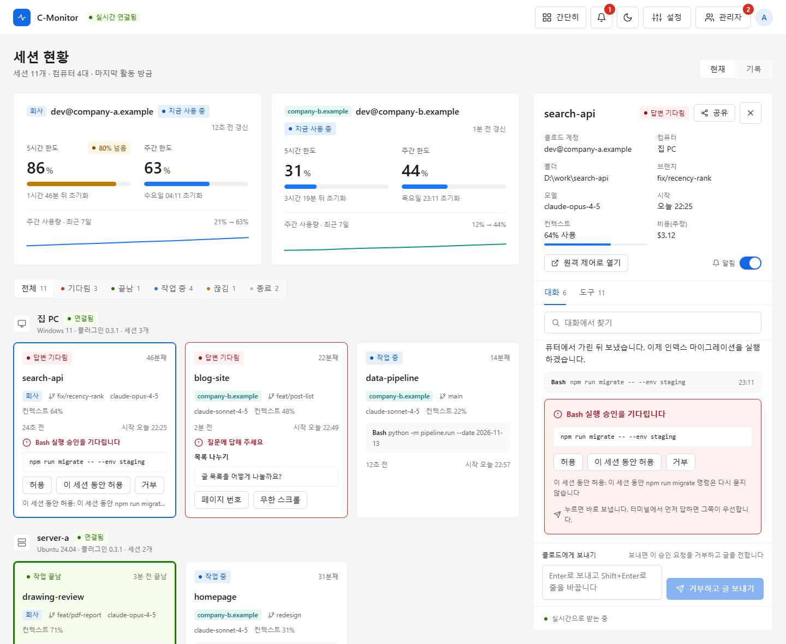
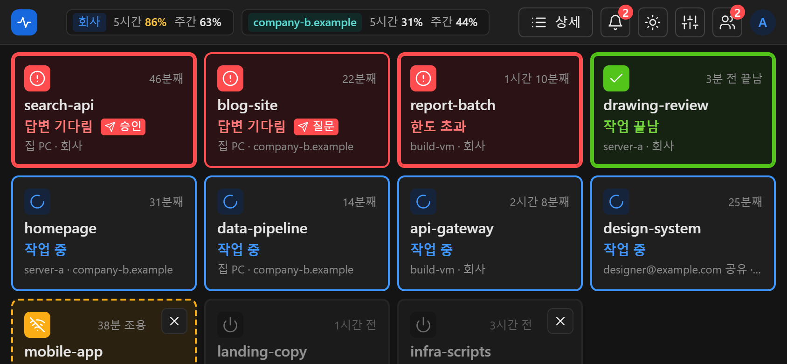
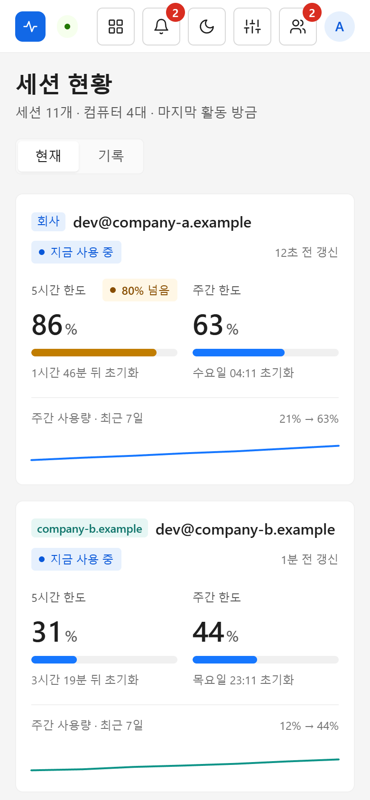
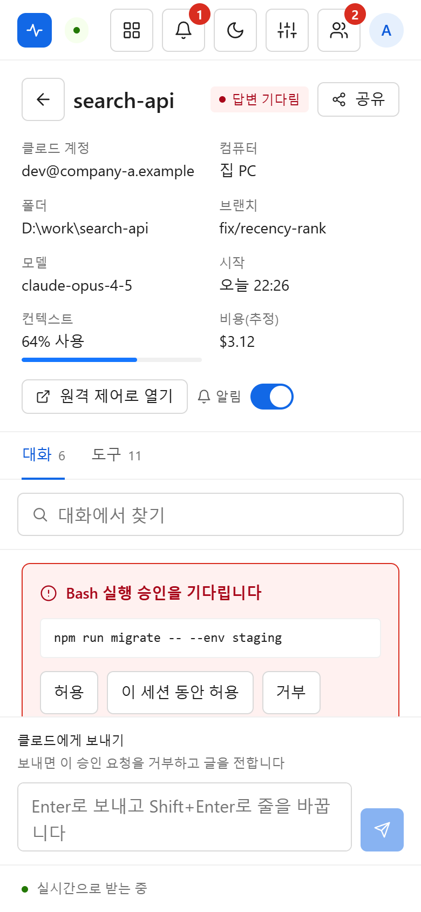
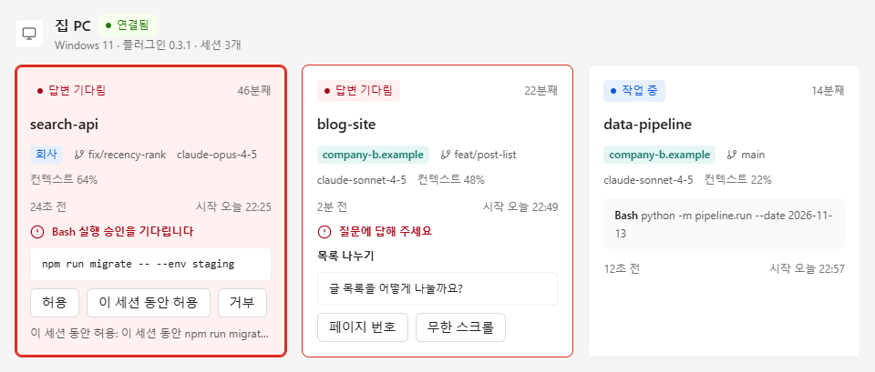
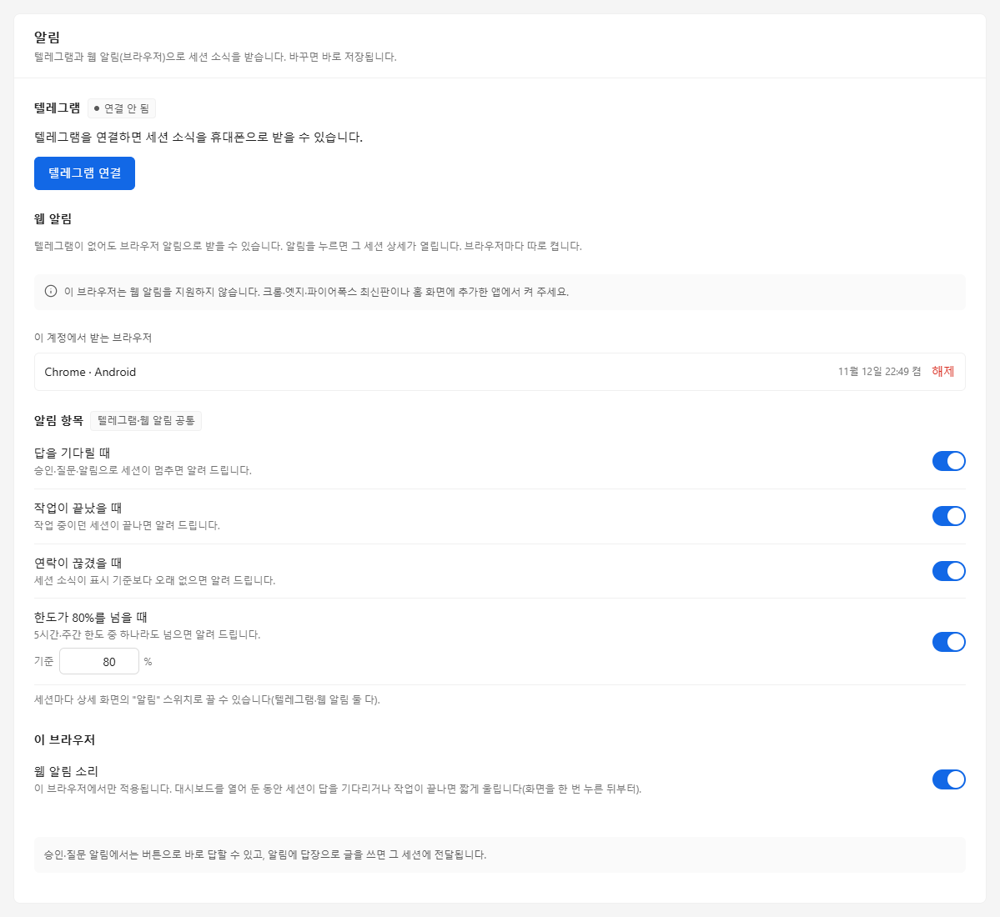

# C-Monitor

여러 컴퓨터에서 도는 클로드코드 세션의 상태·대화·5시간/주간 한도를 한 화면에서 실시간으로 보고, 답을 기다리는 세션에 웹이나 텔레그램에서 바로 답하는 대시보드와, 그 정보를 주고받는 클로드코드 플러그인입니다.

집 PC에서 하나, 서버에서 둘, 빌드용 가상 머신에서 하나 — 이렇게 세션이 흩어져 있어도 어느 세션이 승인을 기다리는지, 어느 세션이 끝났는지, 어느 계정의 한도가 바닥나는지를 브라우저 하나로 보고, 터미널 앞에 없어도 승인하거나 다음 지시를 보냅니다. 휴대폰에서도 같은 화면을 씁니다.

- 눌러 볼 수 있는 데모: <https://korthomasjeong.github.io/c-monitor/> (실제 화면을 예시 데이터로 돌리는 데모이며 실제 서버와 연결되지 않습니다)
- 사용 설명서: [docs/guide/](docs/guide/README.md)



<table>
<tr>
<td width="50%"></td>
<td width="25%"></td>
<td width="25%"></td>
</tr>
<tr>
<td>간단히 보기(휴대폰 가로)</td>
<td>휴대폰 목록</td>
<td>휴대폰에서 답하기</td>
</tr>
</table>

## 주요 기능

- **웹에서 바로 답합니다.** 승인 요청에는 허용·이 세션 동안 허용·거부, 선택지 질문에는 선택지 버튼이 카드와 상세 패널에 붙고, 입력창으로 다음 지시를 보냅니다. 터미널의 창도 그대로 떠 있어 먼저 답한 쪽이 적용됩니다. `/remote-control`을 켠 세션은 공식 원격 제어 화면으로 여는 버튼이 생깁니다. 컴퓨터마다 켜고 끌 수 있습니다.
- **텔레그램과 웹 알림으로 받습니다.** 답을 기다릴 때, 작업이 끝났을 때, 연락이 끊겼을 때, 한도가 기준을 넘을 때 알리고, 텔레그램에서는 버튼이나 답장으로 바로 답합니다. 세션마다 알림을 끌 수 있고, 대시보드를 열어 두면 짧은 소리도 납니다.
- **카드 색으로 상태를 봅니다.** 빨강은 답변·승인을 기다리는 세션(열어 보면 깜박임이 멈춤), 초록은 작업이 끝난 세션(다음 작업을 시작할 때까지 깜박임), 파랑은 작업 중, 주황 점선은 연락이 끊긴 세션, 회색은 종료된 세션입니다.
- **컴퓨터별로 묶어 보여 줍니다.** 컴퓨터마다 연결 상태와 운영체제, 플러그인 버전이 함께 나오고, 세션이 없는 컴퓨터도 묶음으로 보입니다. 위쪽 필터로 상태별로 골라 볼 수 있습니다.
- **대화를 실시간으로 봅니다.** 카드를 누르면 그 세션의 대화와 도구 사용 기록이 오른쪽(휴대폰은 전체 화면)에 이어서 표시됩니다. 처음에는 최근 100줄을 보여 주고, "이전 대화 더 보기"로 앞부분을 100줄씩 더 불러옵니다. 세션별 컨텍스트 사용률과 비용(추정)도 함께 나옵니다.
- **대화를 검색합니다.** 세션의 저장된 대화 전체에서 글자를 찾아 결과 목록으로 보여 주고, 결과를 누르면 그 줄로 옮겨 가 찾은 글자를 강조합니다.
- **지난 세션을 기록 탭에서 봅니다.** 목록에서 빠진 오래된 종료 세션도 검색·컴퓨터 필터로 찾아 대화를 봅니다.
- **끝난 세션을 지웁니다.** 종료·연락 끊김 세션은 카드의 지우기 버튼으로 확인 없이 바로 지웁니다. 저장된 대화 기록까지 서버에서 지워지며 되돌릴 수 없습니다.
- **세션을 공유합니다.** 만료를 정한 링크(로그인 없이 보기만)나 가입한 사람 지정으로 세션 하나를 보여 줍니다. 컴퓨터 정보와 다른 세션은 보이지 않습니다.
- **계정별 한도를 봅니다.** 클로드 계정마다 5시간·주간 사용률과 초기화 시각, 최근 7일 추이가 카드로 나옵니다. 80%, 95%를 넘으면 색이 바뀝니다.
- **간단히 보기**를 누르면 타일만 남아, 휴대폰을 가로로 놓거나 남는 모니터에 띄워 두기 좋습니다.
- **비밀은 보내기 전에 가립니다.** API 키·토큰·비밀번호처럼 보이는 글자는 플러그인이 이 컴퓨터에서 `••••••••`로 바꾼 뒤 보냅니다.
- 로그인은 구글 계정으로 하고, 가입 고지에 동의한 뒤 관리자가 승인한(또는 미리 추가한) 사람만 씁니다. 각 사용자는 자기 컴퓨터와 세션, 공유받은 세션만 봅니다. 사용자마다 저장 용량 한도(기본 1GB)가 있고, 설정에서 언제든 탈퇴할 수 있습니다(7일 뒤 완전 삭제, 그 전에는 취소 가능).
- **관리자 화면**에서 가입 승인, 사용자 미리 추가·권한·용량 한도, 남의 대시보드 읽기 전용 보기, 모든 컴퓨터, 텔레그램 봇, 저장 용량을 관리합니다.

> 세션 대화 전체(사용자 글, 클로드의 답, 도구 입력과 결과)가 서버에 저장됩니다. **관리자는 운영을 위해 저장된 대화를 볼 수 있습니다**([자주 묻는 질문](docs/guide/faq.md#관리자는-무엇을-볼-수-있나요)).

<table>
<tr>
<td width="50%"></td>
<td width="50%"></td>
</tr>
<tr>
<td>카드에서 바로 답하기</td>
<td>설정 › 알림</td>
</tr>
</table>

## 플러그인 설치와 연결

지금 플러그인 버전은 0.3.1입니다. 원격 답장은 0.2.0, 세션별 컨텍스트·비용은 0.3.0부터 됩니다.

클로드코드 안에서:

```
/plugin marketplace add KORThomasJeong/c-monitor
/plugin install c-monitor@c-monitor
/c-monitor:connect https://c-monitor.example.com
```

서버 주소는 예시이니 연결할 서버 주소로 바꿔 넣습니다. 연결 명령을 실행하면 승인 링크와 확인 코드가 바로 화면에 나오고, 데스크톱에서는 브라우저가 그 링크로 자동으로 열립니다(SSH 접속처럼 화면이 없는 환경에서는 열지 않습니다). 구글로 로그인하고, 화면의 컴퓨터 이름과 확인 코드가 터미널과 같은지 본 뒤 "연결 승인"을 누르면 끝입니다. 그 뒤로는 이 컴퓨터의 세션이 자동으로 전송됩니다. 처음 로그인하는 사람은 관리자 승인을 먼저 받아야 합니다. 자세한 순서는 [시작하기](docs/guide/getting-started.md)에 있습니다.

플러그인을 설치하기 전에 이미 열려 있던 세션은 대시보드에 올라오지 않습니다. 그 세션에서 `/reload-plugins`를 실행하거나 클로드코드를 다시 시작해 주세요.

업데이트는 터미널에서 `claude plugin marketplace update c-monitor`, `claude plugin update c-monitor@c-monitor`를 차례로 실행한 뒤 클로드코드를 다시 시작하거나 열려 있는 세션마다 `/reload-plugins`를 실행합니다. `/reload-plugins`를 하지 않은 세션은 옛 버전 훅으로 계속 돌아서, 0.1.x에서 올린 경우 그 세션에는 웹에서 답할 수 없습니다.

보내기 전에 API 키·토큰·비밀번호처럼 보이는 글자는 플러그인이 가립니다. 서버가 꺼져 있어도 클로드코드는 느려지지 않고, 못 보낸 내용은 다음에 이어서 보냅니다.

## 설명서

| 문서 | 내용 |
|---|---|
| [시작하기](docs/guide/getting-started.md) | 가입 고지와 동의, 가입 신청과 관리자 승인, 플러그인 설치와 업데이트, 연결 명령, 연결 승인·거부 |
| [대시보드](docs/guide/dashboard.md) | 카드 색과 깜박임 규칙, 카드에서 바로 답하기, 컴퓨터별 묶음, 공유받은 세션, 상태 필터, 기록 탭, 테마 |
| [간단히 보기](docs/guide/deck-mode.md) | 타일 화면, 휴대폰 가로 화면 |
| [세션 상세](docs/guide/session-detail.md) | 대화·도구 탭, 컨텍스트·비용, 100줄씩 불러오기, 대화 검색, 글 입력창, 답 기록 줄, 세션 지우기 |
| [사용 한도](docs/guide/limits.md) | 계정별 5시간·주간 한도 카드, 색 기준, 계정이 많을 때 |
| [설정](docs/guide/settings.md) | 내 컴퓨터(원격 답장 스위치·연결 해제), 계정 별칭·숨기기, 알림, 표시 기준, 보관 기간, 계정 |
| [관리자](docs/guide/admin.md) | 가입 승인, 사용자 미리 추가·권한·용량 한도·정지·탈퇴 복구, 남의 대시보드 읽기 전용 보기, 모든 컴퓨터, 텔레그램 봇, 저장 용량 |
| [원격 답장](docs/guide/remote-reply.md) | 웹에서 승인·선택지·글 보내기, 터미널 우선, 자동 모드, 원격 제어로 열기, 컴퓨터별 스위치 |
| [알림](docs/guide/notifications.md) | 텔레그램 연결과 버튼·답장으로 답하기, 웹 알림과 소리, 항목별·세션별 스위치, 봇 토큰 넣기 |
| [공유](docs/guide/sharing.md) | 링크 공유와 만료, 사람 지정, 공개 링크 화면, 공유받은 세션 |
| [계정](docs/guide/account.md) | 가입 고지와 동의, 저장 용량, 탈퇴와 탈퇴 취소 |
| [플러그인](docs/guide/plugin.md) | 보내는 것과 보내지 않는 것, 비밀 가림, 원격 답장 훅, 서버가 꺼졌을 때, 상태줄 래퍼, 연결 해제, 업데이트, 파일 위치 |
| [직접 서버 올리기](docs/guide/self-hosting.md) | 도커 컴포즈, 환경변수, 배포 스크립트, 프록시 설정 |
| [구글 로그인 설정](docs/guide/google-oauth.md) | 직접 올린 서버에 쓸 구글 OAuth 클라이언트 만들기 |
| [자주 묻는 질문](docs/guide/faq.md) | 대화가 저장되는 곳, 관리자가 볼 수 있는 것, 지우는 방법, 웹 답장과 알림 |

## 폴더

| 폴더 | 내용 |
|---|---|
| `shared/` | 서버·웹·플러그인이 함께 따르는 API 계약과 상태 규칙 |
| `server/` | 수집·조회 API, 로그인, 기기 연결, 실시간 스트림, 원격 답장, 텔레그램·웹 알림, 공유 (Hono + Postgres) |
| `web/` | 대시보드 화면 (React) |
| `plugin/` | 클로드코드 플러그인 (의존성 없는 Node 스크립트) |
| `deploy/` | 도커 이미지와 컴포즈 구성 |
| `docs/` | 사용 설명서(`guide/`), 설계 문서, 구현 계획, 디자인 목업 |

## 개발

```
npm install
npm test                 # 전체 테스트
npm run dev -w server    # 서버 (저장소 루트의 .env.dev 사용)
npm run dev -w web       # 웹 (http://localhost:5173, API는 3000으로 넘김)
```

Node 22 이상이 필요합니다. 서버 테스트는 `.env.dev`의 `DATABASE_URL`이 가리키는 Postgres에 임시 스키마를 만들어 쓰고 끝나면 지웁니다. 플러그인 테스트만 돌리려면 `npm run test:plugin`을 씁니다.

## 배포

`deploy/env.prod.example`을 서버의 `deploy/.env.prod`로 복사해 값을 채운 뒤:

```
docker compose -f deploy/compose.yml --env-file deploy/.env.prod up -d --build
```

그 뒤의 업데이트는 서버의 저장소 폴더에서 `bash deploy/deploy.sh`로 합니다. DB 백업 → 최신 코드 받기(`git pull --ff-only`) → 빌드·기동 → 정상 확인을 차례로 합니다.

앱 컨테이너(`c-monitor-app:3000`)는 호스트 포트를 열지 않고 프록시 네트워크로만 들어옵니다. 실시간 스트림을 위해 프록시에서 버퍼링을 꺼야 합니다(`proxy_buffering off;`). 환경변수와 프록시 설정은 [직접 서버 올리기](docs/guide/self-hosting.md)에 정리했습니다.
