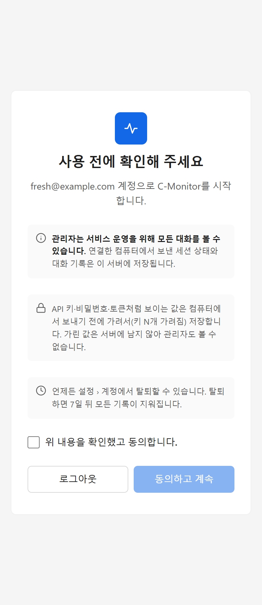
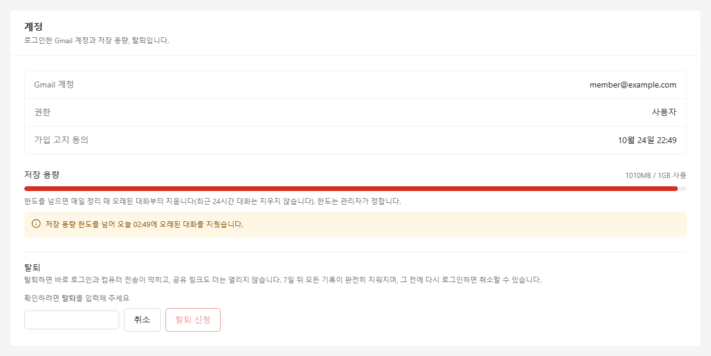
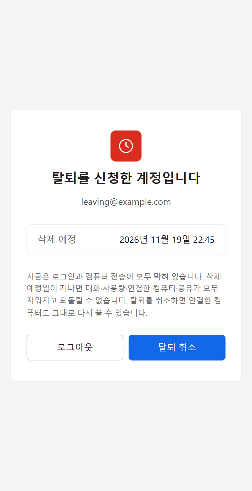

# 계정

대시보드에 로그인하는 Gmail 계정과 관련된 것들입니다. 처음 들어올 때의 가입 고지·동의, 내 저장 용량, 탈퇴와 탈퇴 취소를 다룹니다. 모두 **설정 › 계정**과 로그인 직후 화면에서 봅니다.

## 가입 고지와 동의

처음 로그인하면 대시보드보다 먼저 "사용 전에 확인해 주세요" 화면이 나옵니다. 다음 세 가지를 읽고 **위 내용을 확인했고 동의합니다**에 표시한 뒤 **동의하고 계속**을 눌러야 다음으로 넘어갑니다.

1. **관리자는 서비스 운영을 위해 모든 대화를 볼 수 있습니다.** 연결한 컴퓨터에서 보낸 세션 상태와 대화 기록은 서버에 저장됩니다.
2. API 키·비밀번호·토큰처럼 보이는 값은 컴퓨터에서 보내기 전에 가려서("키 N개 가려짐") 저장합니다. 가린 값은 서버에 남지 않아 관리자도 볼 수 없습니다.
3. 언제든 설정 › 계정에서 탈퇴할 수 있고, 탈퇴하면 7일 뒤 모든 기록이 지워집니다.

동의하지 않으려면 **로그아웃**을 누릅니다. 동의하기 전에는 가입 신청이 관리자에게 가지 않습니다. 동의한 뒤의 흐름은 계정마다 다릅니다.

| 계정 | 동의한 뒤 |
|---|---|
| 처음 가입하는 사람 | "승인을 기다리고 있습니다" 화면. 관리자에게 가입 신청 알림이 갑니다([시작하기](getting-started.md#1-가입-신청과-승인)) |
| 관리자가 미리 추가해 둔 사람 | 승인 없이 바로 대시보드 |
| 서버의 `ADMIN_EMAILS`에 있는 사람 | 승인 없이 바로 관리자로 대시보드 |

동의한 시각은 서버에 저장되고, **설정 › 계정**의 "가입 고지 동의"에 나옵니다.

## 설정 › 계정

| 항목 | 내용 |
|---|---|
| Gmail 계정 | 로그인한 구글 계정 |
| 권한 | 관리자 또는 사용자 |
| 가입 고지 동의 | 동의한 시각 |
| 저장 용량 | 내 기록이 차지하는 크기와 한도. 한도가 있으면 막대로 보이고, 80%를 넘으면 주황, 95%를 넘으면 빨강입니다 |
| 탈퇴 | 탈퇴 신청 |

## 저장 용량

사용자마다 서버에 저장할 수 있는 크기에 한도가 있습니다. 기본은 1GB이고, 관리자가 사용자별로 바꿉니다(0은 한도 없음, [관리자 — 사용자](admin.md#사용자)). 내 사용량은 저장된 대화 줄(글 본문과 도구 입력)의 크기에 한도 기록 수만큼을 더한 값으로, 데이터베이스 색인 같은 부가 공간은 넣지 않은 "내 데이터"의 크기입니다.

한도를 넘으면 서버가 매일 새벽 4시(한국 시간) 정리 때 **오래된 대화 줄부터** 지워 한도 안으로 맞춥니다.

- 보관 기간이 지난 기록을 먼저 지운 뒤에도 넘는 경우에만 지웁니다([설정 — 보관 기간](settings.md#보관-기간)).
- **최근 24시간 대화는 지우지 않습니다.**
- 지우면 텔레그램·웹 알림으로 알리고(알림 항목 설정과 상관없이), 설정 › 계정에 "저장 용량 한도를 넘어 …에 오래된 대화를 지웠습니다"가 나옵니다.
- 세션 카드의 요약 정보(폴더, 브랜치, 상태, 마지막 활동 한 줄)는 이 정리로 지워지지 않습니다.

용량을 아끼려면 끝난 세션을 지우거나([세션 상세 — 세션 지우기](session-detail.md#세션-지우기)) 대화 보관 기간을 줄이면 됩니다.

## 탈퇴

1. **설정 › 계정**의 **탈퇴**를 누릅니다.
2. 확인 칸에 `탈퇴`를 그대로 입력하고 **탈퇴 신청**을 누릅니다.

탈퇴를 신청하면 바로 다음 일이 일어납니다.

- 로그인과 컴퓨터 전송이 모두 막힙니다. 연결한 컴퓨터가 보내는 내용을 서버가 받지 않습니다.
- 내가 만든 공유 링크가 더는 열리지 않습니다.
- 텔레그램으로도 답할 수 없습니다.

**7일 뒤에는 대화·사용량·연결한 컴퓨터·공유가 모두 완전히 지워지고 되돌릴 수 없습니다.** 관리자 화면에는 그 사이 "탈퇴 예정"과 삭제 예정 시각이 표시됩니다.

### 탈퇴 취소

7일이 지나기 전에 다시 로그인하면 "탈퇴를 신청한 계정입니다" 화면이 나옵니다. 삭제 예정 시각을 확인하고 **탈퇴 취소**를 누르면 원래대로 돌아가며, 연결한 컴퓨터도 그대로 다시 씁니다(연결 명령을 다시 실행할 필요가 없습니다). 관리자도 관리 화면에서 복구하거나, 기다리지 않고 바로 지울 수 있습니다.

