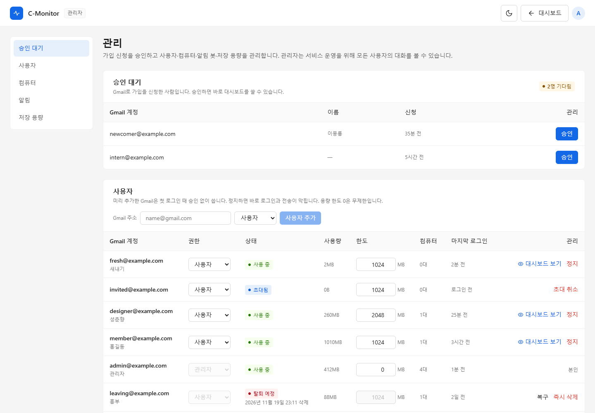
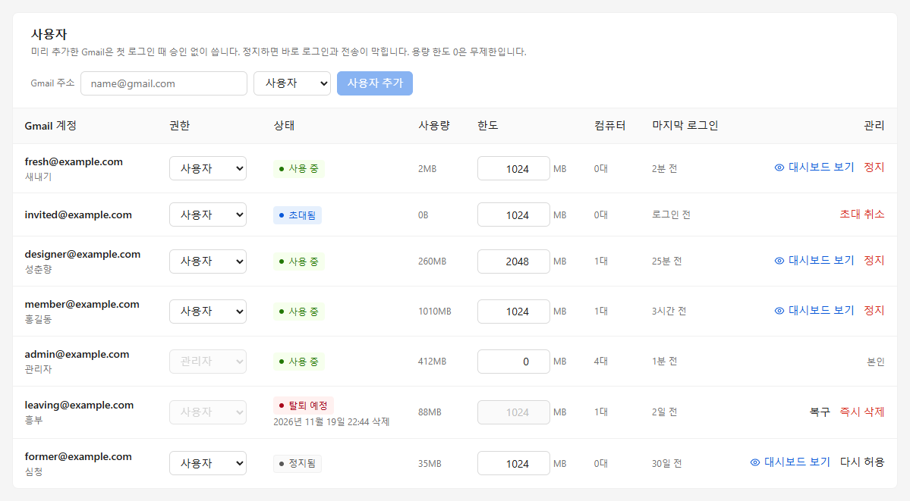
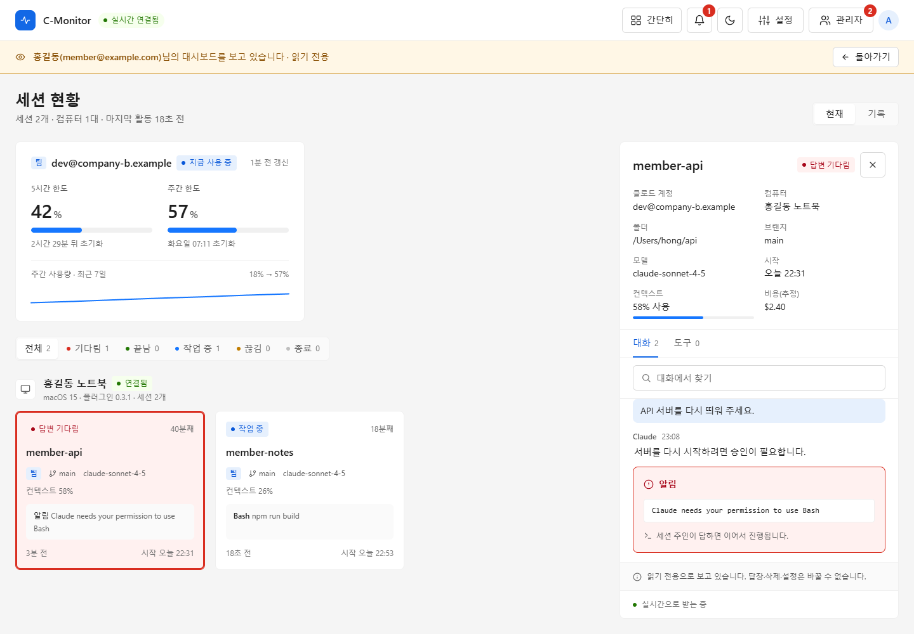
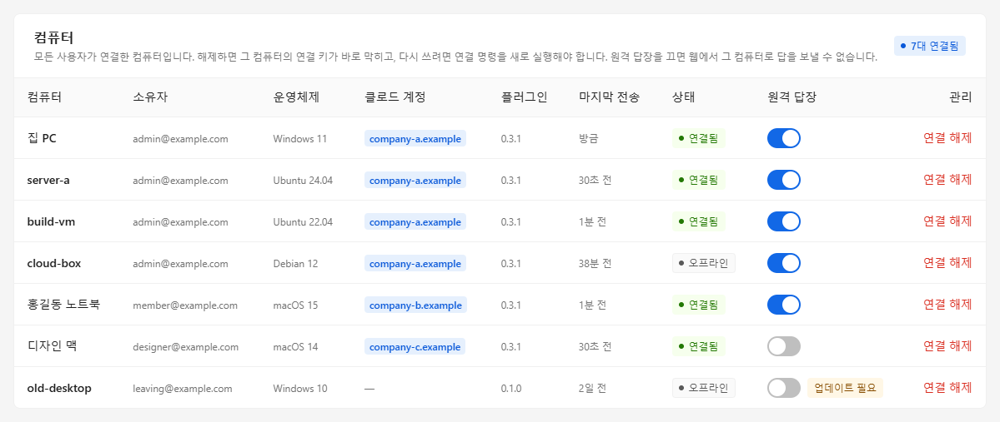
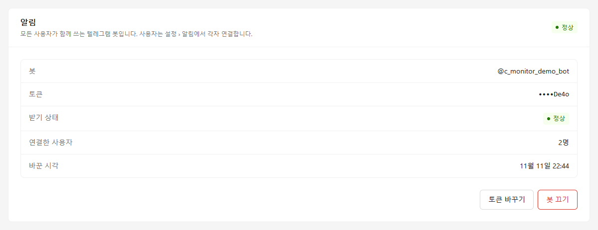
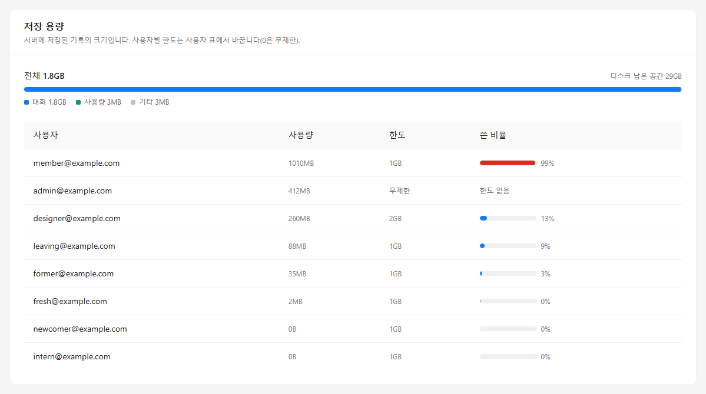

# 관리자

관리자는 가입 신청을 승인하고, 사용자·컴퓨터·텔레그램 알림 봇·저장 용량을 관리합니다. 관리자에게는 대시보드 헤더에 "관리자" 버튼이 보이고, 버튼의 숫자가 승인 대기 인원입니다. 관리 화면의 왼쪽 메뉴는 승인 대기, 사용자, 컴퓨터, 알림, 저장 용량입니다. 관리자가 아닌 사용자가 관리 화면 주소를 열면 "들어갈 수 없습니다"가 나옵니다.

## 누가 관리자인가

두 가지 방법으로 관리자가 됩니다.

- 서버 환경변수 `ADMIN_EMAILS`에 적은 구글 계정 주소(쉼표로 구분). 이 주소로 처음 로그인하면 승인 없이 바로 관리자가 되고, 이미 가입해 있던 사용자도 나중에 이 목록에 넣으면 다음 로그인 때 관리자로 올라갑니다. `ADMIN_EMAILS`를 비워 두면 처음에 가입을 승인할 사람이 없으니, 서버를 직접 올릴 때 꼭 채워 주세요([직접 서버 올리기](self-hosting.md)).
- 다른 관리자가 [사용자](#사용자) 표에서 권한을 "관리자"로 바꾸거나, 처음부터 관리자로 [미리 추가](#사용자-미리-추가)한 사람.

자기 자신의 관리자 권한은 내릴 수 없습니다.

## 승인 대기

가입 고지에 동의하고 승인을 기다리는 사람이 여기에 쌓입니다([계정 — 가입 고지와 동의](account.md#가입-고지와-동의)). 이메일과 구글 계정 이름, 신청한 시각이 나오고, **승인**을 누르면 그 사람은 바로 대시보드를 쓸 수 있습니다. 승인 대기 화면은 20초마다 스스로 확인하므로 승인된 사람은 저절로 들어옵니다.

가입 신청을 거절하는 버튼은 따로 없습니다. 승인하지 않고 두면 그 사람은 계속 승인 대기 상태로 남아 아무것도 볼 수 없습니다.

### 가입 신청 알림

누군가 가입을 신청하면 모든 관리자에게 알림이 갑니다. 텔레그램을 연결한 관리자에게는 "👤 가입 신청" 메시지가, 웹 알림을 켠 관리자에게는 브라우저 알림이 가고, 누르면 관리 화면이 열립니다. 알림 항목 설정과 상관없이 보냅니다([알림](notifications.md)).

## 사용자

승인된 사용자, 미리 추가한 사용자, 정지된 사용자, 탈퇴 예정인 사용자를 한 표에서 봅니다.

| 칸 | 내용 |
|---|---|
| Gmail 계정 | 이메일과 구글 계정 이름 |
| 권한 | 관리자 / 사용자. 고르면 바로 바뀝니다 |
| 상태 | 사용 중, 초대됨(미리 추가했고 아직 로그인 전), 정지됨, 탈퇴 예정(삭제 예정 시각과 함께) |
| 사용량 | 그 사용자의 저장 용량 사용량. 한도를 넘었으면 빨갛게 표시합니다 |
| 한도 | 저장 용량 한도(MB). 0은 무제한. 숫자를 고치고 Enter를 누르거나 칸을 벗어나면 저장합니다 |
| 컴퓨터 | 연결한 컴퓨터 수 |
| 마지막 로그인 | 마지막으로 로그인한 때. 초대된 사람은 "로그인 전" |

관리 칸의 버튼은 상태에 따라 다릅니다.

| 상태 | 버튼 |
|---|---|
| 사용 중 | **대시보드 보기**, **정지** |
| 정지됨 | **대시보드 보기**, **다시 허용** |
| 초대됨 | **초대 취소**(한 번 더 눌러 확인) |
| 탈퇴 예정 | **복구**, **즉시 삭제**(한 번 더 눌러 확인) |
| 본인 | "본인"으로만 표시 |

- **정지**하면 그 사용자는 바로 대시보드를 쓸 수 없고("사용이 정지된 계정입니다"), 그 사용자의 컴퓨터가 보내는 내용도 서버가 받지 않습니다. 저장된 기록은 지우지 않습니다. 정지된 사용자는 **다시 허용**으로 되돌립니다. 자기 자신은 정지할 수 없습니다.
- **복구**는 사용자의 탈퇴 신청을 취소합니다. 그 사람은 다시 로그인해 원래대로 씁니다.
- **즉시 삭제**는 7일을 기다리지 않고 그 사용자의 대화·사용량·컴퓨터·공유를 모두 지웁니다. 되돌릴 수 없습니다.

### 사용자 미리 추가

사용자 표 오른쪽 위의 칸에 Gmail 주소를 넣고 권한(사용자·관리자)을 고른 뒤 **사용자 추가**를 누릅니다. 그 사람은 첫 로그인 때 승인 없이 바로 씁니다. 가입 고지 동의는 다른 사람과 똑같이 받습니다. 이미 있는 사용자면 "이미 있는 사용자입니다"라고 알려 줍니다.

### 저장 용량 한도

사용자마다 기본 1GB(1024MB)입니다. 한도를 넘으면 매일 새벽 4시(한국 시간) 정리 때 그 사용자의 오래된 대화 줄부터 지우고(최근 24시간 대화는 남김) 그 사용자에게 알립니다. 0을 넣으면 한도가 없습니다. 자세한 동작은 [계정 — 저장 용량](account.md#저장-용량)에 있습니다.

### 남의 대시보드 보기

**대시보드 보기**를 누르면 그 사용자의 대시보드가 읽기 전용으로 열립니다. 헤더 아래에 "…님의 대시보드를 보고 있습니다 · 읽기 전용" 띠가 붙고, 세션·대화·검색·기록을 그 사용자가 보는 그대로 볼 수 있습니다.

- 답 버튼, 입력창, 세션 지우기, 공유, 알림 스위치가 모두 빠집니다. 서버도 남의 세션에 대한 답장·삭제·설정 변경을 막습니다.
- 카드를 열어도 "봤음"으로 기록하지 않으므로 그 사용자 화면의 빨간 깜박임은 그대로 남습니다.
- 띠의 **돌아가기**로 관리 › 사용자로 돌아갑니다.

## 컴퓨터

모든 사용자가 연결한 컴퓨터를 한 표에서 봅니다. 컴퓨터 이름, 소유자, 운영체제, 마지막으로 쓴 클로드 계정, 플러그인 버전, 마지막 전송, 연결 상태, 원격 답장 스위치가 나옵니다.

- **원격 답장** 스위치를 끄면 웹과 텔레그램에서 그 컴퓨터로 답을 보낼 수 없습니다. 사용자가 설정에서 바꾸는 스위치와 같은 값입니다([원격 답장 — 컴퓨터별 스위치](remote-reply.md#컴퓨터별-스위치)). 플러그인이 0.2.0보다 낮으면 "업데이트 필요"가 붙습니다.
- **연결 해제**(한 번 더 눌러 확인)하면 그 컴퓨터의 연결 키가 바로 막히고, 다시 쓰려면 그 컴퓨터에서 연결 명령을 새로 실행해야 합니다. 사용자가 설정에서 해제한 것과 같은 처리입니다([설정 — 내 컴퓨터](settings.md#내-컴퓨터)).

## 알림

모든 사용자가 함께 쓰는 텔레그램 봇 토큰을 넣고 바꾸고 끕니다. 넣는 법과 각 칸의 뜻은 [알림 — 관리자가 할 일](notifications.md#관리자가-할-일-봇-토큰-넣기)에 있습니다.

## 저장 용량

서버에 저장된 기록의 크기입니다. 전체 크기와 그중 대화·사용량·기타의 몫, 서버 디스크의 남은 공간, 사용자별 사용량·한도·쓴 비율(80% 이상 주황, 95% 이상 빨강)이 나옵니다. 사용자별 한도는 [사용자](#사용자) 표에서 바꿉니다.

## 관리자가 볼 수 있는 것

관리 화면 설명과 로그인·가입 고지 화면에 적힌 대로, **관리자는 서비스 운영을 위해 모든 사용자의 대화를 볼 수 있습니다.** 웹 화면에서는 [남의 대시보드 보기](#남의-대시보드-보기)로 다른 사용자의 세션 목록, 저장된 대화, 대화 검색, 기록을 봅니다. 다른 사용자의 세션에 답하거나 지우는 것은 관리자도 할 수 없습니다. 또 서버와 데이터베이스를 운영하는 사람은 저장된 모든 데이터에 접근할 수 있습니다. 자세한 내용은 [자주 묻는 질문](faq.md#관리자는-무엇을-볼-수-있나요)에 있습니다.
