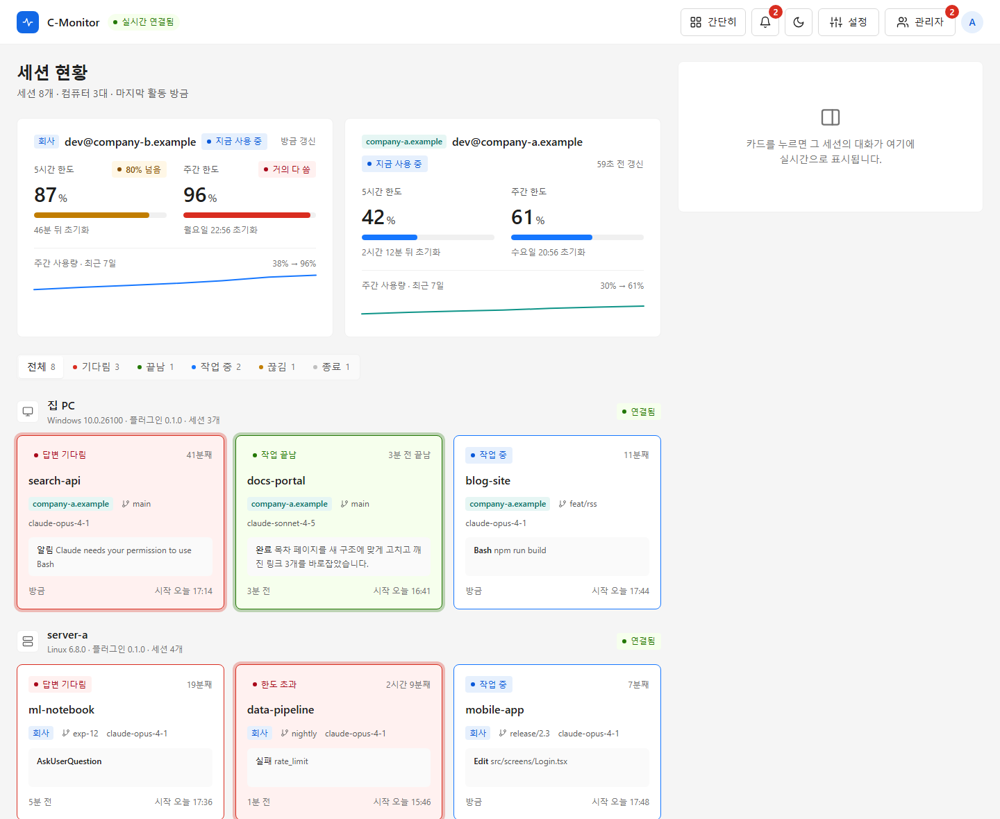
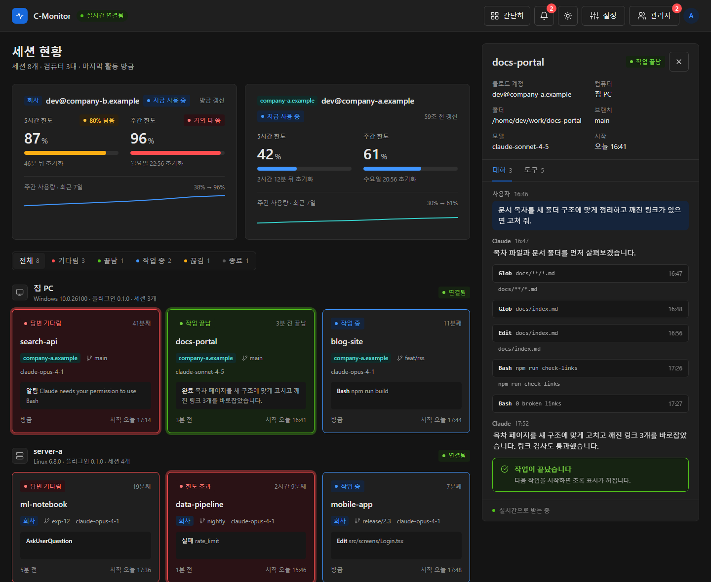
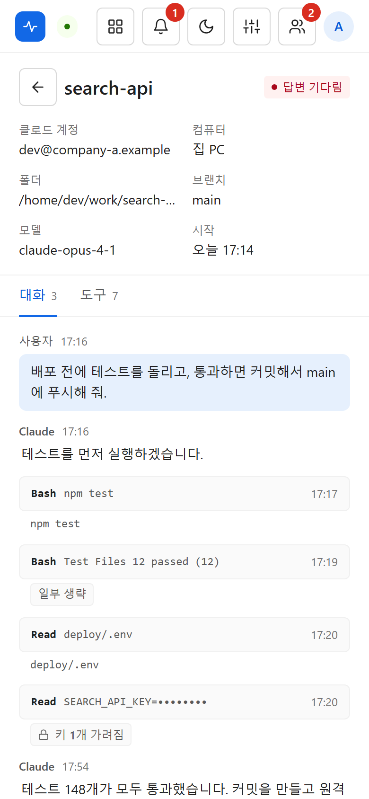

# 대시보드

로그인하면 처음 보이는 화면입니다. 위에서부터 계정별 사용 한도 카드, 상태 필터, 컴퓨터별 세션 카드가 차례로 놓이고, PC에서는 오른쪽에 고른 세션의 상세 패널이 붙습니다.

제목 아래 줄에는 세션 수, 컴퓨터 수, 가장 최근 활동 시각이 나옵니다. 헤더 왼쪽의 "실시간 연결됨"은 서버와 실시간 스트림이 이어져 있다는 뜻입니다. 끊기면 "다시 연결 중"으로 바뀌고 브라우저가 스스로 다시 붙습니다. 다시 붙으면 서버가 전체 상태를 새로 보내 주므로 끊긴 동안의 변화도 반영됩니다.

## 카드 색과 깜박임

세션 카드 하나가 클로드코드 세션 하나입니다. 카드 왼쪽 위 태그와 테두리 색으로 상태를 봅니다.

| 상태 | 태그 | 카드 모양 | 이렇게 바뀝니다 |
|---|---|---|---|
| 답변 기다림 | 빨강 | 열어 보기 전까지 빨갛게 깜박임 | 권한 승인 요청·질문 알림이 오거나 클로드가 선택지 질문(AskUserQuestion)을 띄울 때 |
| 한도 초과 | 빨강 | 답변 기다림과 같음 | 사용 한도에 걸려 작업이 멈췄을 때 |
| 작업 끝남 | 초록 | 다음 작업을 시작할 때까지 초록으로 깜박임 | 클로드가 답을 마쳤을 때 |
| 작업 중 | 파랑 | 테두리가 천천히 밝아졌다 어두워짐 | 질문을 보냈거나 도구를 쓰는 중 |
| 연락 끊김 | 주황 | 주황 점선 테두리 | 작업 중인데 정해진 시간(기본 10분) 넘게 소식이 없을 때 |
| 종료 | 회색 | 흐린 카드 | 세션을 끝냈을 때 |

두 가지 깜박임은 멈추는 조건이 다릅니다.

- **빨강은 카드를 열면 멈춥니다.** 답을 기다리는 카드를 한 번 누르면 "봤음"으로 기록되고, 그 뒤로는 빨간 테두리만 남고 깜박이지 않습니다. 봤음 표시는 서버에 저장되므로 다른 기기에서 열어도 멈춘 상태로 보입니다. 같은 세션이 다시 승인을 요청하면 또 깜박입니다.
- **초록은 열어도 멈추지 않습니다.** 끝난 세션은 그 세션에서 다음 작업이 시작되어 상태가 바뀔 때까지 계속 깜박입니다. 끝난 일을 놓치지 않게 하려는 규칙입니다.

위 그림에서 `search-api`와 `data-pipeline`은 아직 열어 보지 않아 깜박이고, `ml-notebook`은 이미 열어 봐서 빨간 테두리만 남았습니다.

운영체제에서 "애니메이션 줄이기"를 켜 두었다면 깜박임 대신 진한 테두리와 바탕색으로 고정해 보여 줍니다.

카드 안에는 위에서부터 상태와 경과 시간, 폴더 이름(카드 제목), 클로드 계정·브랜치·모델, 마지막 활동 한 줄, 마지막 소식과 시작 시각이 들어갑니다. 카드 제목은 작업 폴더 경로의 마지막 폴더 이름이고, 전체 경로는 제목에 마우스를 올리거나 상세 패널에서 봅니다.

## 정렬

한 묶음 안의 카드는 급한 순서로 놓입니다. 답변 기다림 → 한도 초과 → 작업 끝남 → 작업 중 → 연락 끊김 → 종료 순이고, 같은 상태끼리는 최근 활동이 앞에 옵니다.

## 컴퓨터별 묶음

카드는 연결한 컴퓨터별로 묶입니다. 묶음 머리에는 컴퓨터 이름, 운영체제, 플러그인 버전, 세션 수가 나오고 오른쪽에 연결 상태가 붙습니다. 마지막 전송이 10분 안이면 "연결됨", 그보다 오래되면 "오프라인"이며, 오프라인이면 마지막 신호 시각도 함께 나옵니다. 묶음 순서는 컴퓨터를 연결한 순서입니다. 보여 줄 세션이 하나도 없는 컴퓨터는 묶음이 나타나지 않고, [설정](settings.md)의 "내 컴퓨터" 목록에만 나옵니다.

종료된 세션은 끝나고 24시간(설정값)이 지나면 대시보드에서 빠집니다. [설정](settings.md)의 "종료 카드 유지"에서 바꿀 수 있습니다.

## 상태 필터

카드 위의 필터로 상태별로 골라 봅니다. 전체, 기다림, 끝남, 작업 중, 끊김, 종료가 있고 각 버튼 옆 숫자는 그 상태의 세션 수입니다. "기다림"에는 한도 초과도 함께 들어갑니다. 고른 상태의 세션이 없는 컴퓨터 묶음은 숨겨집니다.

헤더의 종 아이콘 숫자는 아직 열어 보지 않은 빨간 카드(답변 기다림·한도 초과) 수입니다. 종을 누르면 필터가 "기다림"으로 바뀝니다. 브라우저 알림이나 텔레그램 알림은 아직 없습니다(예정).

## 휴대폰과 태블릿

화면 폭이 1024px보다 좁으면 상세 패널이 오른쪽에 붙지 않고, 카드를 누르면 상세가 화면 전체를 차지합니다. 왼쪽 위 화살표로 목록에 돌아옵니다. 768px보다 좁으면 한도 카드가 한 줄에 하나씩 놓이고 헤더 버튼은 아이콘만 남습니다.

<table>
<tr>
<td></td>
<td></td>
</tr>
</table>

## 테마

헤더의 달·해 아이콘으로 라이트와 다크를 바꿉니다. 처음에는 기기의 화면 설정을 따르고, 버튼으로 한 번 바꾸면 그 브라우저에 기억합니다. "간단히 보기"와 "상세" 중 마지막에 쓴 화면도 같은 방식으로 기기별로 기억합니다.

## 헤더 버튼

| 버튼 | 하는 일 |
|---|---|
| 간단히 / 상세 | [간단히 보기](deck-mode.md)와 이 화면을 오갑니다 |
| 종 | 열어 보지 않은 빨간 카드 수. 누르면 "기다림" 필터 |
| 달·해 | 테마 바꾸기 |
| 설정 | [설정](settings.md) 화면 |
| 관리자 | 관리자에게만 보입니다. 숫자는 승인 대기 인원([관리자](admin.md)) |
| 동그란 머리글자 | 지금 로그인한 대시보드 계정. 마우스를 올리면 이메일이 보입니다 |

## 예정

- 카드나 상세 패널에서 바로 답장하기(승인·선택지·글 보내기)는 아직 없습니다. 지금은 답을 기다리는 세션이 있으면 그 컴퓨터의 터미널에서 답해야 합니다.
- 종료된 지 오래된 세션을 모아 보는 기록 화면은 아직 웹에 없습니다.
