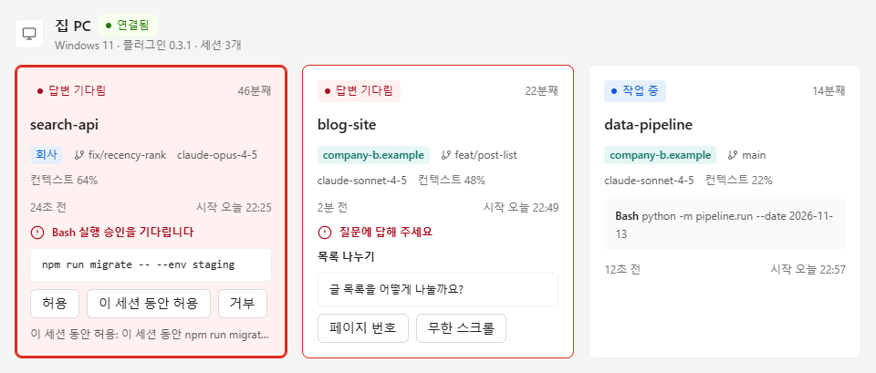
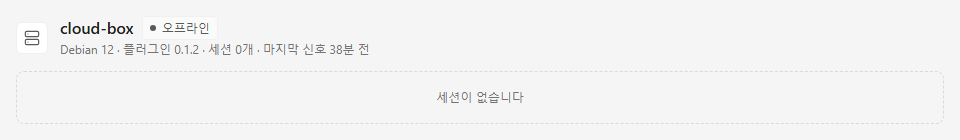
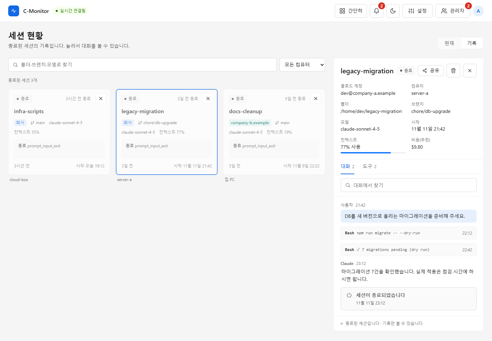
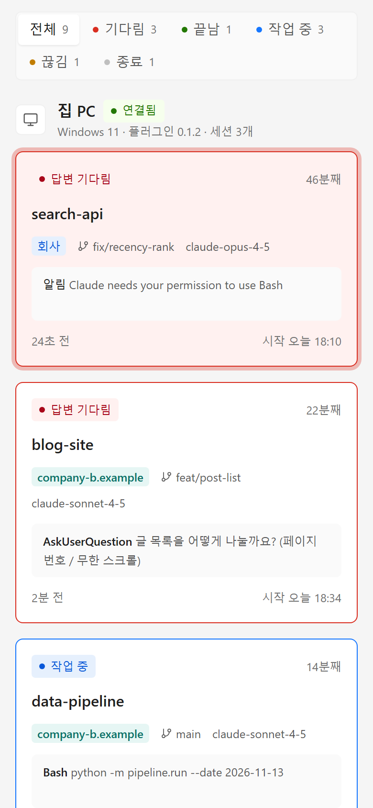

# 대시보드

로그인하면 처음 보이는 화면입니다. 위에서부터 계정별 사용 한도 카드, 상태 필터, 컴퓨터별 세션 카드가 차례로 놓이고, PC에서는 오른쪽에 고른 세션의 상세 패널이 붙습니다. 제목 오른쪽의 **현재 / 기록**으로 지금 세션과 [지난 세션 기록](#기록)을 오갑니다.

제목 아래 줄에는 세션 수, 컴퓨터 수, 가장 최근 활동 시각이 나옵니다. 헤더 왼쪽의 "실시간 연결됨"은 서버와 실시간 스트림이 이어져 있다는 뜻입니다. 끊기면 "다시 연결 중"으로 바뀌고 브라우저가 스스로 다시 붙습니다. 다시 붙으면 서버가 전체 상태를 새로 보내 주므로 끊긴 동안의 변화도 반영됩니다.

## 카드 색과 깜박임

세션 카드 하나가 클로드코드 세션 하나입니다. 카드 왼쪽 위 태그와 테두리 색으로 상태를 봅니다.

| 상태 | 태그 | 카드 모양 | 이렇게 바뀝니다 |
|---|---|---|---|
| 답변 기다림 | 빨강 | 열어 보기 전까지 빨갛게 깜박임 | 실행 승인 요청·질문 알림이 오거나 클로드가 선택지 질문(AskUserQuestion)을 띄울 때 |
| 한도 초과 | 빨강 | 답변 기다림과 같음 | 사용 한도에 걸려 작업이 멈췄을 때 |
| 작업 끝남 | 초록 | 상세에서 "확인 완료"를 누를 때까지 초록으로 깜박임 | 클로드가 답을 마쳤을 때 |
| 작업 중 | 파랑 | 테두리가 천천히 밝아졌다 어두워짐 | 질문을 보냈거나 도구를 쓰는 중 |
| 연락 끊김 | 주황 | 주황 점선 테두리 | 작업 중인데 정해진 시간(기본 10분) 넘게 소식이 없을 때 |
| 종료 | 회색 | 흐린 카드 | 세션을 끝냈을 때 |

두 가지 깜박임은 멈추는 조건이 다릅니다.

- **빨강은 카드를 열면 멈춥니다.** 답을 기다리는 카드를 한 번 누르면 "봤음"으로 기록되고, 그 뒤로는 빨간 테두리만 남고 깜박이지 않습니다. 봤음 표시는 서버에 저장되므로 다른 기기에서 열어도 멈춘 상태로 보입니다. 같은 세션이 다시 승인을 요청하면 또 깜박입니다.
- **초록은 열기만 해서는 멈추지 않습니다.** 끝난 세션을 열어 결과를 보고 이름 옆 **확인 완료**를 누르면, 그 결과를 확인했다는 표시(✓ 확인함)가 남고 카드가 초록에서 진한 회색으로 바뀝니다. 알람 자체를 끄는 것이 아니라 "이번 결과는 봤다"는 확인이라, 그 세션이 다음 작업을 마치면 다시 깜박입니다. 초록으로 깜박이면 아직 확인 안 한 결과, 진한 회색이면 확인한 결과입니다(아예 종료된 세션은 배경 없이 흐리게 보입니다).

위 그림에서 `search-api`는 아직 열어 보지 않아 빨갛게 깜박이고, `blog-site`는 이미 열어 봐서 빨간 테두리만 남았습니다. `drawing-review`는 상세 패널에 열려 있어도 "확인 완료"를 누르기 전까지 초록으로 깜박입니다.

운영체제에서 "애니메이션 줄이기"를 켜 두었다면 깜박임 대신 진한 테두리와 바탕색으로 고정해 보여 줍니다.

카드 안에는 위에서부터 상태와 경과 시간, 폴더 이름(카드 제목), 클로드 계정·브랜치·모델·컨텍스트 사용률, 마지막 활동 한 줄, 마지막 소식과 시작 시각이 들어갑니다. 카드 제목은 작업 폴더 경로의 마지막 폴더 이름이고, 전체 경로는 제목에 마우스를 올리거나 상세 패널에서 봅니다.

- **컨텍스트 N%**는 그 세션이 컨텍스트 창을 얼마나 썼는지입니다. 상태줄이 그려질 때 플러그인이 보내므로 플러그인 0.3.0 이상에서, 상태줄이 한 번 이상 그려진 세션에만 나옵니다([세션 상세 — 컨텍스트와 비용](session-detail.md#컨텍스트와-비용)).
- 그 세션의 알림을 꺼 두었으면 경과 시간 옆에 종 모양에 빗금이 그어진 표시가 붙습니다([알림 — 세션별로 끄기](notifications.md#세션별로-끄기)).

### 카드에서 바로 답하기

승인이나 선택지 질문을 기다리는 세션은 카드 안에 답 버튼이 붙습니다. 마지막 활동 한 줄 대신 실행하려는 내용과 **허용 / 이 세션 동안 허용 / 거부** 버튼, 또는 질문과 선택지 버튼이 나옵니다. 카드를 열지 않고 눌러도 되고, 누르면 확인 없이 바로 보냅니다. 자세한 규칙은 [원격 답장](remote-reply.md)에 있습니다.

종료된 카드와 연락 끊김 카드에는 오른쪽 위에 × 모양의 **지우기** 버튼이 붙습니다. 누르면 확인 창 없이 바로 그 세션과 서버에 저장된 대화 기록까지 지워지고, 되돌릴 수 없습니다. 자세한 내용은 [세션 상세 — 세션 지우기](session-detail.md#세션-지우기)에 있습니다.

## 정렬

한 묶음 안의 카드는 급한 순서로 놓입니다. 답변 기다림 → 한도 초과 → 작업 끝남 → 작업 중 → 연락 끊김 → 종료 순이고, 같은 상태끼리는 최근 활동이 앞에 옵니다.

## 컴퓨터별 묶음

카드는 연결한 컴퓨터별로 묶입니다. 묶음 머리 첫 줄에는 컴퓨터 이름과 그 바로 옆에 연결 상태 태그가, 둘째 줄에는 운영체제, 플러그인 버전, 세션 수가 나옵니다. 마지막 전송이 10분 안이면 "연결됨", 그보다 오래되면 "오프라인"이며, 오프라인이면 둘째 줄 끝에 마지막 신호 시각도 함께 나옵니다. 묶음 순서는 컴퓨터를 연결한 순서입니다.

보여 줄 세션이 하나도 없는 컴퓨터도 묶음이 나타나고, 그 안에 "세션이 없습니다"라고 적힙니다. 방금 연결해서 아직 세션이 없는 컴퓨터, 세션을 모두 지운 컴퓨터, 종료된 세션이 모두 목록에서 빠진 컴퓨터가 여기에 해당합니다. 단, 상태 필터를 "전체" 말고 다른 것으로 골랐을 때는 그 상태의 세션이 없는 묶음을 숨깁니다.

종료된 세션은 끝나고 24시간(설정값)이 지나면 "현재" 목록에서 빠지고 [기록](#기록)에서만 보입니다. [설정](settings.md#표시-기준)의 "종료 카드 유지"에서 바꿀 수 있습니다. 연결을 해제한 컴퓨터는 묶음과 세션이 모두 대시보드에서 빠집니다.

### 공유받은 세션

다른 사람이 사람 지정으로 공유해 준 세션은 컴퓨터 묶음 아래의 **공유받은 세션** 묶음에 모입니다. 카드에 공유한 사람이 붙고, 보기만 할 수 있습니다([공유](sharing.md#공유받은-세션)).

## 상태 필터

카드 위의 필터로 상태별로 골라 봅니다. 전체, 기다림, 끝남, 작업 중, 끊김, 종료가 있고 각 버튼 옆 숫자는 그 상태의 세션 수입니다. "기다림"에는 한도 초과도 함께 들어갑니다. "전체"가 아닌 필터를 고르면 그 상태의 세션이 없는 컴퓨터 묶음은 숨겨집니다.

헤더의 종 아이콘 숫자는 아직 열어 보지 않은 내 빨간 카드(답변 기다림·한도 초과) 수입니다. 종을 누르면 필터가 "기다림"으로 바뀝니다. 대시보드를 닫아 두어도 소식을 받으려면 텔레그램 알림이나 웹 알림을 켭니다([알림](notifications.md)).

## 기록

제목 오른쪽의 **기록**을 누르면 종료된 세션을 모아 봅니다. "종료 카드 유지" 시간이 지나 지금 목록에서 빠진 세션도 여기에는 남아 있습니다. 최근에 끝난 세션부터 놓이고, 카드 아래에 그 세션의 컴퓨터 이름이 붙습니다.

- 위쪽 칸에 글자를 넣으면 폴더 이름·경로, 브랜치, 모델, 마지막 활동 글에서 찾아 거릅니다. 옆의 "모든 컴퓨터"에서 컴퓨터 하나만 고를 수도 있습니다.
- 카드를 누르면 오른쪽에 그 세션의 대화가 열립니다. 대화 검색과 "이전 대화 더 보기"는 그대로 되고, 끝난 세션이라 답 버튼과 입력창은 없습니다.
- 카드의 × 버튼이나 상세 패널의 휴지통 버튼으로 지웁니다. 확인 없이 바로 지워지고 되돌릴 수 없습니다([세션 상세 — 세션 지우기](session-detail.md#세션-지우기)).
- 보관 기간이 지나 대화가 정리된 세션은 카드만 남고 대화가 비어 있을 수 있습니다([설정 — 보관 기간](settings.md#보관-기간)).
- **현재**를 누르면 지금 세션 화면으로 돌아갑니다.

## 관리자가 남의 대시보드를 볼 때

관리자가 [관리 › 사용자](admin.md#남의-대시보드-보기)에서 "대시보드 보기"를 누르면 그 사용자의 대시보드가 같은 모양으로 열리고, 헤더 아래에 "…님의 대시보드를 보고 있습니다 · 읽기 전용" 띠가 붙습니다. 이때는 답 버튼, 입력창, 지우기, 공유, 알림 스위치가 모두 빠지고, 카드를 열어도 "봤음"으로 기록하지 않습니다. 띠의 **돌아가기**로 관리 화면으로 돌아갑니다.

## 휴대폰과 태블릿

PC에서는 제목 줄이 왼쪽·오른쪽 전체 폭에 걸쳐 있어, 오른쪽 상세 패널의 윗선이 왼쪽 첫 카드(한도 카드)의 윗선과 맞춰집니다.

화면 폭이 1024px보다 좁으면 상세 패널이 오른쪽에 붙지 않고, 카드를 누르면 상세가 화면 전체를 차지합니다. 왼쪽 위 화살표로 목록에 돌아옵니다. 768px보다 좁으면 한도 카드가 한 줄에 하나씩 놓이고, 헤더 버튼은 아이콘만 남고, 상태 필터는 두 줄로 줄바꿈되어 모든 버튼이 한 화면에 보입니다.

<table>
<tr>
<td></td>
<td></td>
</tr>
</table>

## 테마

헤더의 달·해 아이콘으로 라이트와 다크를 바꿉니다. 처음에는 기기의 화면 설정을 따르고, 버튼으로 한 번 바꾸면 그 브라우저에 기억합니다. "간단히 보기"와 "상세" 중 마지막에 쓴 화면도 같은 방식으로 기기별로 기억합니다.

## 헤더 버튼

| 버튼 | 하는 일 |
|---|---|
| 간단히 / 상세 | [간단히 보기](deck-mode.md)와 이 화면을 오갑니다 |
| 현재 / 기록 | 제목 오른쪽. 지금 세션과 [기록](#기록)을 오갑니다 |
| 종 | 열어 보지 않은 빨간 카드 수. 누르면 "기다림" 필터 |
| 달·해 | 테마 바꾸기 |
| 설정 | [설정](settings.md) 화면 |
| 관리자 | 관리자에게만 보입니다. 숫자는 승인 대기 인원([관리자](admin.md)) |
| 동그란 머리글자 | 지금 로그인한 대시보드 계정. 마우스를 올리면 이메일이 보입니다 |
