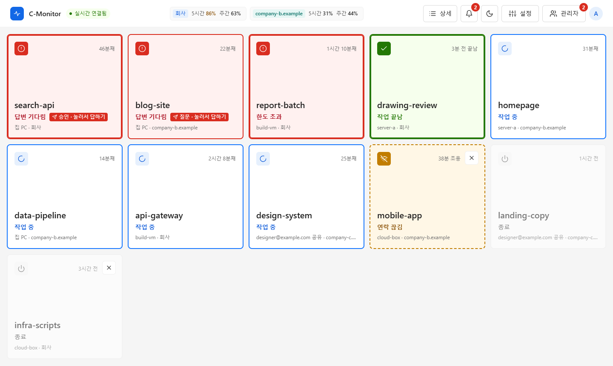
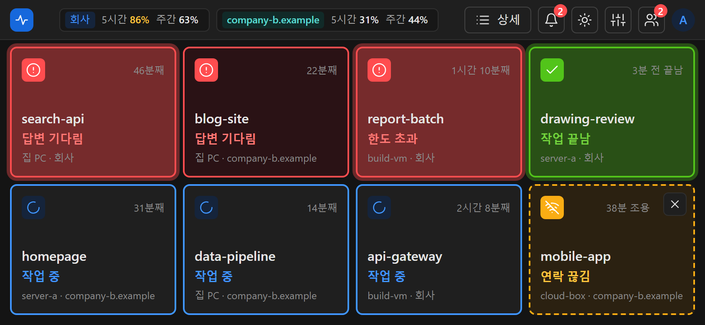

# 간단히 보기

헤더의 "간단히" 버튼을 누르면 한도 카드와 필터, 컴퓨터 묶음이 사라지고 세션 타일만 남습니다. 남는 모니터나 휴대폰에 띄워 두고 곁눈으로 상태를 보는 용도입니다. "상세" 버튼을 누르면 원래 화면으로 돌아갑니다.

## 타일

타일 하나가 세션 하나입니다. 아이콘과 색이 [대시보드](dashboard.md)의 카드 규칙을 그대로 따릅니다.

| 상태 | 아이콘 | 모양 |
|---|---|---|
| 답변 기다림·한도 초과 | 느낌표 | 빨강. 열어 보지 않았으면 깜박임 |
| 작업 끝남 | 체크 | 초록. 타일을 눌러 상세에서 "확인 완료"를 누를 때까지 깜박임 |
| 작업 중 | 도는 원 | 파랑 테두리 |
| 연락 끊김 | 끊긴 와이파이 | 주황 점선 |
| 종료 | 전원 | 회색 |

타일에는 폴더 이름, 상태, 컴퓨터 이름과 계정 이름, 경과 시간이 들어갑니다. 연락 끊김 타일은 "13분 조용"처럼 소식이 없던 시간을, 종료 타일은 끝난 시각을 보여 줍니다. 타일은 컴퓨터와 상관없이 한데 모아 급한 순서(답변 기다림 → 한도 초과 → 작업 끝남 → 작업 중 → 연락 끊김 → 종료)로 놓입니다.

타일을 누르면 상세 화면으로 돌아가면서 그 세션의 상세 패널이 열립니다. 빨간 타일이라면 이때 "봤음"으로 기록되어 깜박임이 멈춥니다.

웹에서 답할 수 있는 승인·질문을 기다리는 타일에는 상태 옆에 "승인 · 눌러서 답하기" 또는 "질문 · 눌러서 답하기"가 붙습니다. 타일에는 답 버튼이 없으니, 눌러서 열린 상세 패널에서 답합니다([원격 답장](remote-reply.md)).

공유받은 세션도 타일로 함께 나옵니다. 이 타일은 보기만 할 수 있습니다([공유](sharing.md#공유받은-세션)).

연락 끊김·종료 타일에는 오른쪽 위에 × 모양의 지우기 버튼이 붙습니다. 대시보드 카드의 지우기 버튼과 같아서, 누르면 확인 없이 바로 그 세션과 서버에 저장된 대화 기록이 지워지고 되돌릴 수 없습니다([세션 상세 — 세션 지우기](session-detail.md#세션-지우기)). 아래 휴대폰 가로 그림의 `mobile-app` 타일에서 볼 수 있습니다.

헤더 가운데에는 최근에 갱신된 계정 두 개까지의 5시간·주간 사용률이 작은 알약 모양으로 나옵니다. 계정이 더 있으면 "외 N"이 붙습니다. 80% 이상은 주황, 95% 이상은 빨강 숫자로 표시합니다.

## 화면 크기별 배치

| 화면 | 배치 |
|---|---|
| PC·태블릿 | 타일 폭이 240px 이상이 되도록 열 수를 자동으로 맞추고, 화면 높이를 채웁니다. 타일이 많으면 스크롤됩니다 |
| 휴대폰 세로(폭 768px 미만) | 2열. 헤더의 한도 알약은 숨깁니다 |
| 휴대폰 가로(높이 500px 이하) | 4열. 세션이 8개까지면 한 화면에 맞추고, 8개를 넘으면 타일 높이를 유지한 채 세로로 스크롤합니다. 헤더를 낮추고 한도 알약을 다시 보여 줍니다 |

휴대폰을 가로로 눕히면 세션 8개까지 한 화면에 들어갑니다. 아래는 844×390 화면을 다크 테마로 본 모습입니다.

간단히 보기와 상세 화면 중 마지막으로 쓴 쪽은 그 브라우저에 기억되어, 다음에 열 때도 같은 화면으로 시작합니다.
