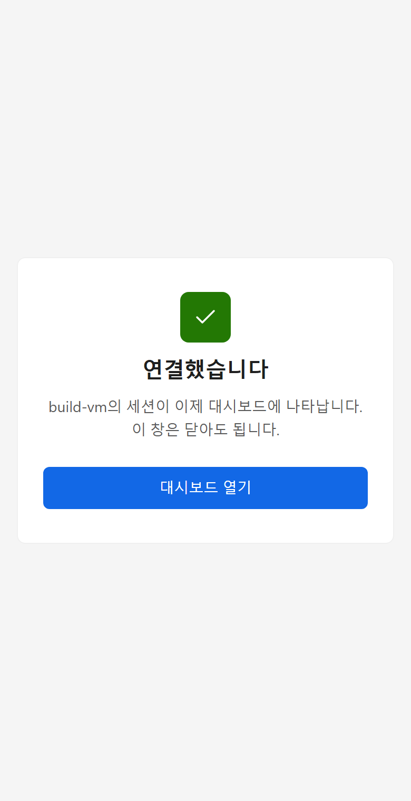

# 시작하기

C-Monitor를 쓰려면 두 가지가 필요합니다. 웹 대시보드에 로그인할 수 있는 승인된 계정, 그리고 세션을 볼 컴퓨터마다 설치한 플러그인입니다. 이 문서는 연결할 서버 주소를 예시 `https://c-monitor.example.com`으로 적었습니다. 실제로 쓰는 서버 주소로 바꿔 읽으면 됩니다([직접 서버 올리기](self-hosting.md)). 구글 로그인 설정은 [google-oauth.md](google-oauth.md)에 있습니다.

## 1. 가입 신청과 승인

대시보드 주소를 열면 로그인 화면이 나옵니다. "Gmail 계정으로 로그인"을 눌러 구글 계정으로 로그인하면 그 자체가 가입 신청이 됩니다.


로그인 화면에 적힌 대로, 대시보드 로그인 계정은 클로드 계정과 별개입니다. 클로드코드에 어떤 계정으로 로그인했는지와 상관없이, 대시보드에는 구글 계정으로 들어옵니다. 서버는 구글이 이메일을 확인해 준 계정만 받습니다. 로그인 화면에는 관리자가 서비스 운영을 위해 저장된 대화를 볼 수 있다는 점도 적혀 있습니다([자주 묻는 질문](faq.md#관리자는-무엇을-볼-수-있나요)).

처음 로그인하면 "승인을 기다리고 있습니다" 화면이 나옵니다. 이 화면은 20초마다 승인 여부를 스스로 확인하고, 승인되면 저절로 넘어갑니다. 바로 확인하려면 "승인 확인"을 누릅니다. 서버의 `ADMIN_EMAILS`에 적힌 주소는 승인 없이 바로 관리자로 들어옵니다.

지금은 가입 신청이 와도 관리자에게 따로 알림이 가지 않습니다. 관리자는 대시보드 위쪽 "관리자" 버튼의 숫자로 대기 인원을 봅니다. 승인이 급하면 관리자에게 직접 알려 주세요. 관리자 알림(텔레그램)은 예정입니다.

### 승인 전에 연결 링크를 열었을 때

3단계의 연결 링크를 가입 승인 전에 열어도 연결 코드는 사라지지 않습니다. 로그인하지 않은 상태라면 구글 로그인을 거친 뒤 그 링크로 돌아오고, 승인 대기 중이라면 승인 대기 화면에 그 링크가 함께 표시됩니다. 승인이 확인되면 그 링크(연결 승인 화면)로 저절로 돌아갑니다.


다만 연결 코드는 10분이 지나면 만료됩니다. 승인이 그보다 늦어지면 터미널에서 연결 명령을 다시 실행해 새 코드를 받아 주세요.

## 2. 플러그인 설치

세션을 볼 컴퓨터의 클로드코드 안에서 실행합니다.

```
/plugin marketplace add KORThomasJeong/c-monitor
/plugin install c-monitor@c-monitor
```

플러그인은 Node 18 이상이 필요하고(`node` 명령이 PATH에 있어야 합니다), 다른 의존성은 없습니다.

> **설치하기 전에 시작한 세션은 대시보드에 올라오지 않습니다.** 훅은 세션이 시작될 때 붙기 때문입니다. 이미 열려 있던 세션도 보이게 하려면 그 세션에서 `/reload-plugins`를 실행하거나 클로드코드를 다시 시작해 주세요.

## 3. 연결 명령

```
/c-monitor:connect https://c-monitor.example.com
```

이 명령은 두 단계로 돌아갑니다. 먼저 서버에 연결을 요청해 승인 링크와 확인 코드를 바로 화면에 보여 주고(`--start`), 그다음 브라우저에서 승인할 때까지 최대 10분 기다립니다(`--wait`). 클로드코드는 명령이 끝나야 출력을 보여 주기 때문에, 링크를 먼저 보여 준 뒤에 기다리도록 나눠 두었습니다.

첫 단계의 터미널 출력은 다음과 같습니다(주소와 코드는 예시입니다). 첫 줄이 승인 링크, 둘째 줄이 확인 코드입니다.

```
● 승인 링크  https://c-monitor.example.com/connect?code=K7QM-2XPA
  확인 코드  K7QM-2XPA

  서버에 연결을 요청했습니다.
  브라우저를 열었습니다. 구글로 로그인한 뒤 코드를 확인하고 승인해 주세요. (열리지 않았다면 위 링크로 들어가면 됩니다.)
  https://c-monitor.example.com/connect?code=K7QM-2XPA

  10분 안에 승인하지 않으면 코드가 만료됩니다.
```

데스크톱에서는 기본 브라우저가 승인 링크로 자동으로 열립니다. 다음 경우에는 브라우저를 열지 않고 "아래 링크를 직접 열어 주세요"라고 안내하니, 링크를 다른 기기에서 열면 됩니다.

- SSH로 접속한 터미널
- 화면이 없는 Linux(`DISPLAY`·`WAYLAND_DISPLAY`가 없음)
- 환경변수 `C_MONITOR_NO_OPEN=1`을 설정했거나 명령 끝에 `--no-open`을 붙였을 때

## 4. 연결 승인

링크를 열면 연결 승인 화면이 나옵니다. 화면에는 확인 코드와 함께 연결을 요청한 컴퓨터의 이름(호스트 이름)과 운영체제, 승인하는 사람(지금 로그인한 대시보드 계정)이 나옵니다. 터미널의 확인 코드와 화면의 코드가 같은지, 내가 연결하려는 컴퓨터가 맞는지 확인한 뒤 "연결 승인"을 누릅니다. 연결된 컴퓨터는 승인한 대시보드 계정의 소유가 됩니다.

<table>
<tr>
<td></td>
<td></td>
</tr>
</table>

승인하면 터미널이 이어서 다음처럼 끝납니다(컴퓨터 이름은 예시입니다).

```
✓ 승인되었습니다. 이 컴퓨터를 dev-laptop 로 등록했습니다.
✓ 상태줄에 한도 전송을 연결했습니다. 기존 상태줄은 그대로 보입니다.
  이제 이 컴퓨터의 모든 세션이 자동으로 전송됩니다.
```

원래 쓰던 상태줄이 없었다면 둘째 줄은 "✓ 상태줄에 한도 전송을 연결했습니다."로만 나옵니다. 링크 없이 `/connect` 주소만 열었다면 코드 입력 칸이 나오니 터미널의 코드를 넣으면 됩니다.

**거부**를 누르면 서버에 거부가 전달되어, 기다리던 터미널도 몇 초 안에 다음처럼 끝납니다. 거부한 코드는 다시 쓸 수 없으니, 다시 연결하려면 연결 명령을 새로 실행합니다.

```
✗ 거부되었거나 만료되었습니다. 다시 연결해 주세요.
```

10분 안에 승인하지 않아 코드가 만료된 경우에도 같은 문구로 끝납니다. 이미 처리했거나 만료된 코드로 승인 화면을 열면 "만료되었거나 이미 처리된 코드입니다"가 나옵니다.

## 5. 확인

연결이 끝나면 그 컴퓨터에서 도는 클로드코드 세션이 훅 이벤트가 생길 때마다 서버로 전송되고, 대시보드에 컴퓨터 묶음과 세션 카드가 나타납니다. 연결 상태는 인자 없이 명령을 실행해 확인합니다.

```
/c-monitor:connect
```

```
● 연결되어 있습니다.
  서버        https://c-monitor.example.com
  컴퓨터      dev-laptop
  클로드 계정 dev@company-a.example
  상태줄      한도 전송 연결됨
  보낼 묶음   0개 남음
```

세션 카드가 나타나지 않으면 위 2단계의 안내대로 그 세션에서 `/reload-plugins`를 실행해 보세요. 5시간·주간 한도는 상태줄이 그려질 때 함께 전송되므로, 한도 카드는 상태줄이 한 번 이상 표시된 뒤에 나타납니다.

## 플러그인 업데이트

새 버전이 나오면 터미널(클로드코드 밖)에서 다음 두 명령을 차례로 실행합니다.

```
claude plugin marketplace update c-monitor
claude plugin update c-monitor@c-monitor
```

그다음 클로드코드를 다시 시작하거나, 실행 중인 세션에서 `/reload-plugins`를 실행하면 새 버전이 적용됩니다. 연결은 그대로 유지되므로 연결 명령을 다시 실행할 필요는 없습니다. 대시보드의 컴퓨터 묶음에 나오는 플러그인 버전으로 적용 여부를 확인할 수 있습니다. 상태줄 래퍼도 업데이트 뒤 첫 훅에서 자동으로 새 버전이 됩니다([플러그인 — 상태줄 래퍼](plugin.md#상태줄-래퍼)).

## 다음

- 화면 읽는 법: [대시보드](dashboard.md)
- 무엇이 전송되는지: [플러그인](plugin.md)
- 연결을 끊는 법: [플러그인 — 연결 해제](plugin.md#연결-해제), [설정 — 내 컴퓨터](settings.md#내-컴퓨터)
