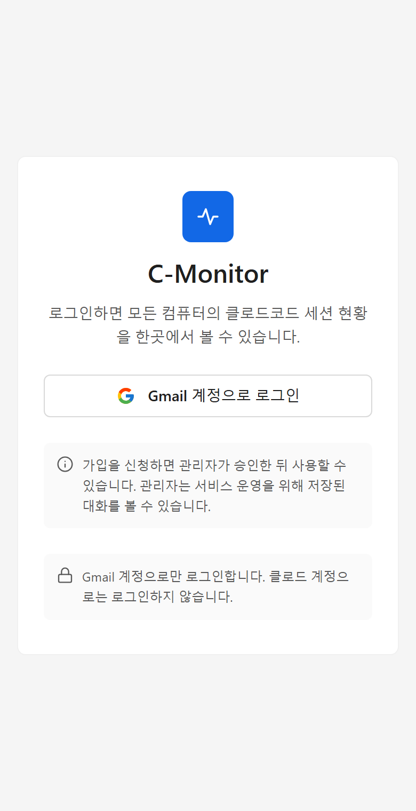
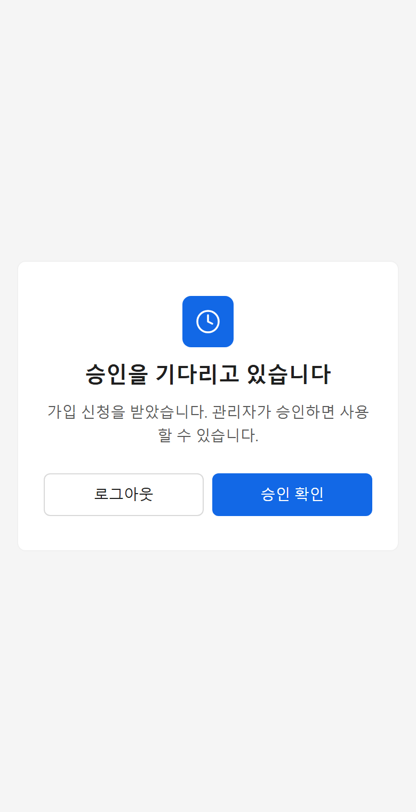
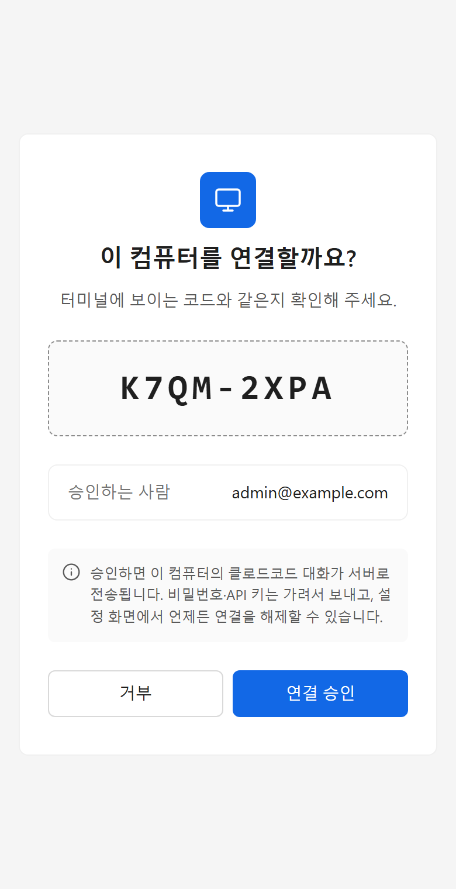

# 시작하기

C-Monitor를 쓰려면 두 가지가 필요합니다. 웹 대시보드에 로그인할 수 있는 승인된 계정, 그리고 세션을 볼 컴퓨터마다 설치한 플러그인입니다. 이 문서는 운영 서버 `https://c-monitor.example.com` 기준으로 적었습니다. 서버를 직접 올렸다면 주소만 바꿔 읽으면 됩니다([직접 서버 올리기](self-hosting.md)). 구글 로그인 설정은 [google-oauth.md](google-oauth.md)에 있습니다.

## 1. 가입 신청과 승인

대시보드 주소를 열면 로그인 화면이 나옵니다. "Gmail 계정으로 로그인"을 눌러 구글 계정으로 로그인하면 그 자체가 가입 신청이 됩니다.



로그인 화면에 적힌 대로, 대시보드 로그인 계정은 클로드 계정과 별개입니다. 클로드코드에 어떤 계정으로 로그인했는지와 상관없이, 대시보드에는 구글 계정으로 들어옵니다. 서버는 구글이 이메일을 확인해 준 계정만 받습니다.

처음 로그인하면 "승인을 기다리고 있습니다" 화면이 나옵니다. 관리자가 승인하면 "승인 확인"을 눌러 대시보드로 들어갑니다. 서버의 `ADMIN_EMAILS`에 적힌 주소는 승인 없이 바로 관리자로 들어옵니다.



지금은 가입 신청이 와도 관리자에게 따로 알림이 가지 않습니다. 관리자는 대시보드 위쪽 "관리자" 버튼의 숫자로 대기 인원을 봅니다. 승인이 급하면 관리자에게 직접 알려 주세요. 관리자 알림(텔레그램)은 예정입니다.

> 가입 승인을 먼저 받은 뒤 다음 단계의 연결 명령을 실행하는 편이 좋습니다. 연결 코드는 10분이 지나면 만료되는데, 승인 전에 연결 링크를 열면 승인 대기 화면으로 넘어가 버리기 때문입니다.

## 2. 플러그인 설치

세션을 볼 컴퓨터의 클로드코드 안에서 실행합니다.

```
/plugin marketplace add KORThomasJeong/c-monitor
/plugin install c-monitor@c-monitor
```

플러그인은 Node 18 이상이 필요하고(`node` 명령이 PATH에 있어야 합니다), 다른 의존성은 없습니다.

## 3. 연결 명령

```
/c-monitor:connect https://c-monitor.example.com
```

명령은 서버에 연결을 요청하고 링크와 확인 코드를 보여 준 뒤, 브라우저에서 승인할 때까지 최대 10분 기다립니다. 터미널에는 다음과 같이 나옵니다(코드와 컴퓨터 이름은 예시입니다).

```
● 서버에 연결을 요청했습니다.
  아래 링크를 열고 구글로 로그인한 뒤 코드를 확인해 주세요.

  https://c-monitor.example.com/connect?code=K7QM-2XPA
  확인 코드  K7QM-2XPA

  10분 안에 승인하지 않으면 코드가 만료됩니다.
  승인을 기다리는 중…
```

## 4. 연결 승인

링크를 열면 연결 승인 화면이 나옵니다. 터미널의 확인 코드와 화면의 코드가 같은지 확인한 뒤 "연결 승인"을 누릅니다. 승인하는 사람에는 지금 로그인한 대시보드 계정이 표시되고, 연결된 컴퓨터는 이 계정의 소유가 됩니다.

<table>
<tr>
<td></td>
<td></td>
</tr>
</table>

승인하면 터미널이 이어서 다음처럼 끝납니다.

```
✓ 승인되었습니다. 이 컴퓨터를 build-vm 로 등록했습니다.
✓ 상태줄에 한도 전송을 연결했습니다. 기존 상태줄은 그대로 보입니다.
  이제 이 컴퓨터의 모든 세션이 자동으로 전송됩니다.
```

컴퓨터 이름은 그 컴퓨터의 호스트 이름이 그대로 쓰입니다. 링크 없이 `/connect` 주소만 열었다면 코드 입력 칸이 나오니 터미널의 코드를 넣으면 됩니다.

웹 화면에서 "거부"를 누르면 그 화면만 닫히고 서버에는 알리지 않습니다. 터미널 쪽은 10분이 지나 코드가 만료될 때까지 기다린 뒤 "거부되었거나 만료되었습니다"로 끝납니다. 바로 끝내고 싶으면 터미널에서 명령을 멈추면 됩니다.

## 5. 확인

연결이 끝나면 그 컴퓨터에서 도는 모든 클로드코드 세션이 훅 이벤트가 생길 때마다 서버로 전송되고, 대시보드에 컴퓨터 묶음과 세션 카드가 나타납니다. 연결 상태는 인자 없이 명령을 실행해 확인합니다.

```
/c-monitor:connect
```

```
● 연결되어 있습니다.
  서버        https://c-monitor.example.com
  컴퓨터      build-vm
  클로드 계정 dev@company-a.example
  상태줄      한도 전송 연결됨
  보낼 묶음   0개 남음
```

설치 직후 이미 열려 있던 세션에서 카드가 나타나지 않으면 클로드코드를 다시 시작해 보세요. 5시간·주간 한도는 상태줄이 그려질 때 함께 전송되므로, 한도 카드는 상태줄이 한 번 이상 표시된 뒤에 나타납니다.

## 다음

- 화면 읽는 법: [대시보드](dashboard.md)
- 무엇이 전송되는지: [플러그인](plugin.md)
- 연결을 끊는 법: [플러그인 — 연결 해제](plugin.md#연결-해제), [설정 — 내 컴퓨터](settings.md#내-컴퓨터)
