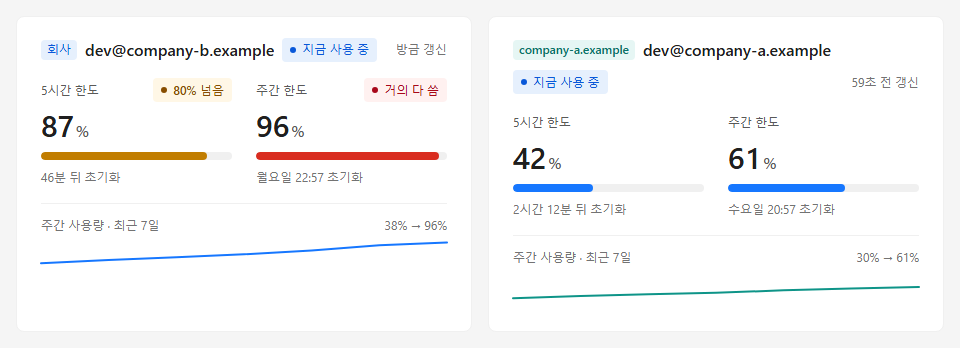
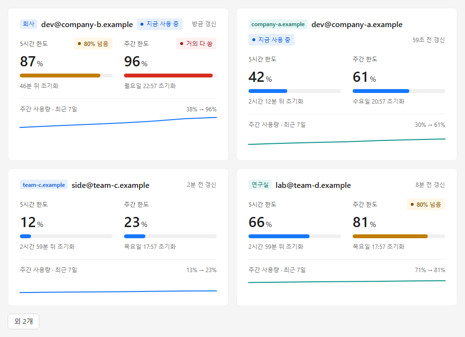

# 사용 한도

대시보드 위쪽에는 클로드 계정마다 한도 카드가 하나씩 놓입니다. 카드 하나에 그 계정의 5시간 한도와 주간 한도 사용률, 초기화 시각, 최근 7일 주간 사용량 추이가 들어갑니다.

## 한도는 어디서 오나

클로드코드가 상태줄을 그릴 때 넘겨주는 입력에는 계정의 5시간·주간 사용률과 초기화 시각이 들어 있습니다. 플러그인의 상태줄 래퍼가 이 값을 읽어 계정마다 60초에 한 번까지만 서버로 보냅니다([플러그인 — 상태줄 래퍼](plugin.md#상태줄-래퍼)). 그래서 한도 카드는 상태줄이 그려지는 동안에만 갱신되고, 카드 오른쪽 위의 "N분 전 갱신"은 마지막으로 받은 시각입니다. 상태줄 입력에 한도 정보가 없으면 한도는 전송되지 않습니다.

계정은 클로드코드에 로그인한 클로드 계정 이메일로 구분합니다. 한 컴퓨터에서 계정을 바꿔 쓰면 바뀐 계정이 바로 따로 잡히고, 내 대시보드 계정에 연결한 여러 컴퓨터에서 같은 클로드 계정을 쓰면 한 카드로 합쳐 보이고, 가장 최근에 받은 값이 표시됩니다. 계정 수에는 제한이 없습니다.

## 카드 읽는 법

| 부분 | 내용 |
|---|---|
| 머리 | 계정 이름표(별칭 또는 이메일 도메인), 이메일, "지금 사용 중"(이 계정으로 작업 중인 세션이 있을 때), 마지막 갱신 시각 |
| 5시간 한도 | 사용률(%)과 막대, 초기화까지 남은 시간 |
| 주간 한도 | 사용률(%)과 막대, 초기화 요일과 시각(하루 안이면 남은 시간) |
| 주간 사용량 · 최근 7일 | 하루에 한 점씩 이은 주간 사용률 선. 오른쪽에 첫 값 → 마지막 값 |

이름표 색은 계정마다 두 가지 색을 번갈아 씁니다. 같은 이름표가 세션 카드에도 붙어, 어느 세션이 어느 계정을 쓰는지 바로 보입니다. 7일 추이의 날짜는 한국 시간 기준으로 나눕니다.

## 색 기준

| 사용률 | 막대 색 | 표시 |
|---|---|---|
| 80% 미만 | 파랑 | 없음 |
| 80% 이상 | 주황 | "80% 넘음" 태그 |
| 95% 이상 | 빨강 | "거의 다 씀" 태그 |

같은 기준이 [간단히 보기](deck-mode.md) 헤더의 한도 알약 숫자 색에도 쓰입니다. 실제로 한도에 걸려 작업이 멈춘 세션은 카드가 "한도 초과"(빨강)로 바뀝니다.

## 계정이 많을 때

한도 카드는 4개까지 보입니다. 숨기지 않은 계정이 4개를 넘으면 최근에 갱신된 4개만 보이고, 그 아래 "외 N개" 버튼이 붙습니다. 버튼을 누르면 모든 계정이 최근 갱신 순으로 펼쳐지고, "접기"로 다시 4개로 돌아갑니다.

간단히 보기의 헤더 알약은 최근 갱신된 두 계정까지만 보이고 나머지는 "외 N"으로 셉니다.

## 별칭과 숨기기

[설정](settings.md#클로드-계정)의 "클로드 계정"에서 계정마다 별칭을 붙이거나 숨길 수 있습니다.

- **별칭**을 넣으면 이름표에 이메일 도메인 대신 별칭이 나옵니다(예: "회사"). 세션 카드와 간단히 보기의 계정 이름에도 같은 별칭이 쓰입니다.
- **숨기기**를 켜면 그 계정은 한도 카드와 헤더 알약에서 빠집니다. 숨겨도 기록은 계속 쌓이고, 그 계정을 쓰는 세션 카드는 그대로 보입니다.

설정 화면에서 바꾼 뒤 "저장"을 눌러야 반영됩니다.
