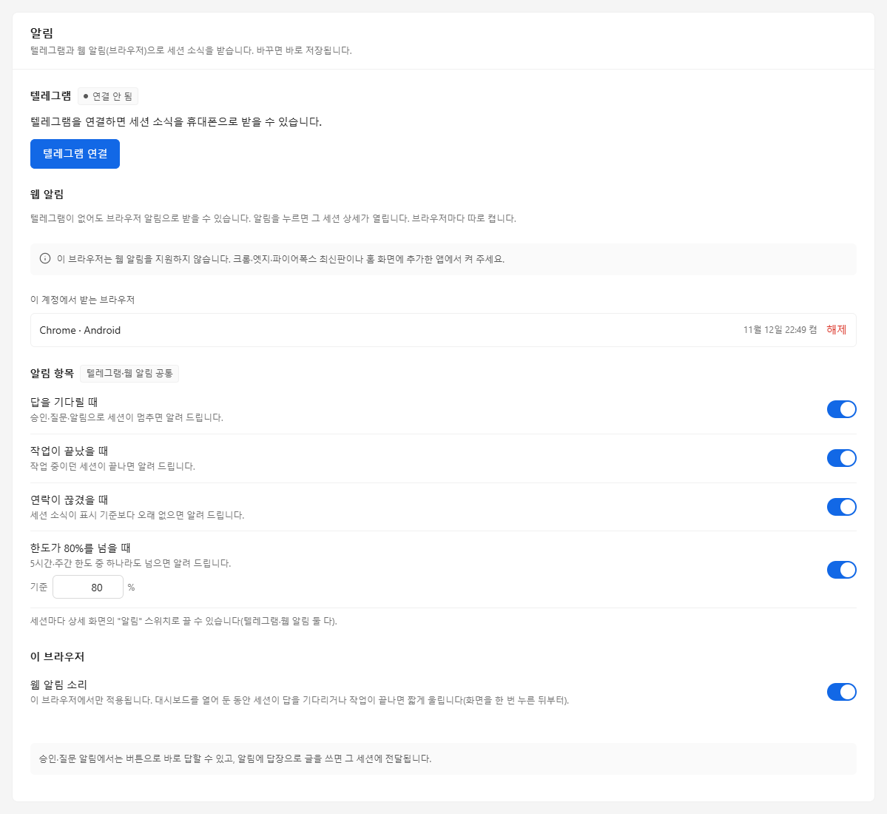
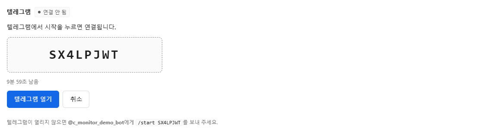
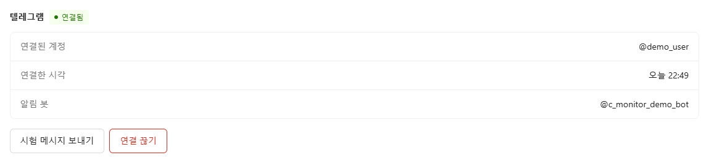
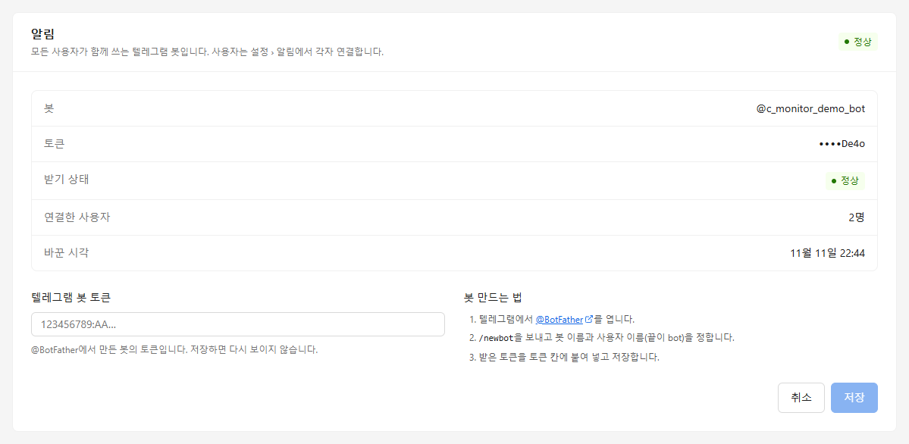
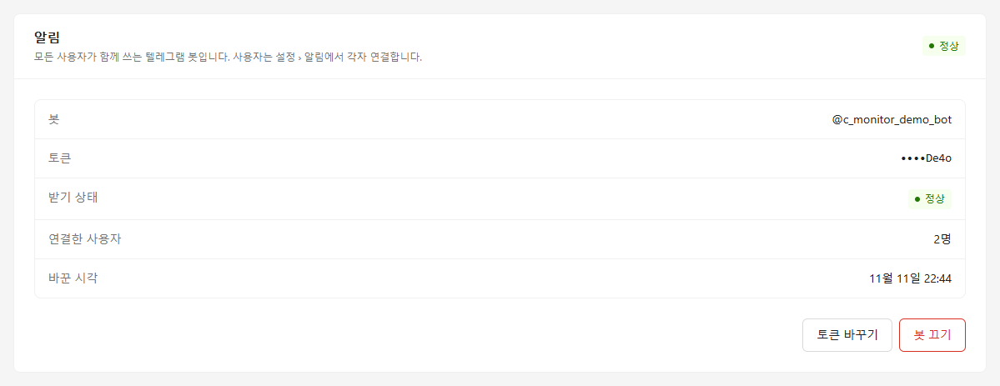

# 알림

대시보드를 열어 두지 않아도 세션 소식을 받습니다. 받는 곳은 세 가지입니다.

| 받는 곳 | 어디서 켜나 | 특징 |
|---|---|---|
| 텔레그램 | 설정 › 알림 › 텔레그램 연결 | 휴대폰으로 받고, 버튼과 답장으로 바로 답할 수 있습니다 |
| 웹 알림 | 설정 › 알림 › 웹 알림 › 이 브라우저에서 받기 | 텔레그램 없이 브라우저·홈 화면 앱 알림으로 받습니다. 누르면 그 세션 상세가 열립니다 |
| 웹 알림 소리 | 설정 › 알림 › 이 브라우저 › 웹 알림 소리 | 대시보드를 열어 둔 동안 짧게 울립니다 |

텔레그램 알림은 서버에 텔레그램 봇이 있어야 합니다. 봇은 관리자가 한 번 넣어 두면 모든 사용자가 함께 씁니다([관리자가 할 일](#관리자가-할-일-봇-토큰-넣기)).

## 알림 항목

텔레그램과 웹 알림은 같은 항목 설정을 따릅니다. 스위치를 바꾸면 저장 버튼 없이 바로 저장됩니다. 텔레그램을 연결하거나 웹 알림을 켠 브라우저가 하나라도 있어야 항목을 고를 수 있습니다.

| 항목 | 기본 | 알리는 때 |
|---|---|---|
| 답을 기다릴 때 | 켜짐 | 승인·질문·알림으로 세션이 멈췄을 때 |
| 작업이 끝났을 때 | 켜짐 | 작업 중이던 세션이 끝났을 때 |
| 연락이 끊겼을 때 | 켜짐 | 세션 소식이 [표시 기준](settings.md#표시-기준)보다 오래 없을 때 |
| 한도가 N%를 넘을 때 | 켜짐, 80% | 5시간·주간 한도 중 하나라도 기준을 넘었을 때. 기준은 50~100% 사이 정수로 바꿉니다. 같은 한도는 초기화될 때까지 한 번만 알립니다 |

다음 두 가지는 항목 설정과 상관없이 보냅니다.

- **저장 용량 정리**: 저장 용량 한도를 넘어 오래된 대화를 지웠을 때 그 사용자에게([계정 — 저장 용량](account.md#저장-용량)).
- **가입 신청**: 누군가 가입 고지에 동의하고 승인을 기다리게 되면 모든 관리자에게([관리자](admin.md#가입-신청-알림)).

## 세션별로 끄기

시끄러운 세션 하나만 조용히 하고 싶으면, 그 세션 상세 패널 머리의 **알림** 스위치를 끕니다. 텔레그램과 웹 알림 둘 다에 적용되고, 꺼 둔 세션의 카드에는 오른쪽 위에 종 모양에 빗금이 그어진 표시가 붙습니다. 텔레그램 알림 아래의 "🔕 이 세션 알림 끄기" 버튼을 눌러도 같습니다.

텔레그램도 웹 알림도 켜지 않았으면 이 스위치는 눌리지 않고, 옆에 "설정 › 알림에서 텔레그램을 연결하거나 웹 알림을 켜면 쓸 수 있습니다"라는 안내가 나옵니다.

## 텔레그램 연결

1. **설정 › 알림**의 텔레그램에서 **텔레그램 연결**을 누릅니다.
2. 연결 코드와 남은 시간(10분)이 나오고, PC에서는 새 탭으로 텔레그램이 열립니다. 휴대폰에서는 **텔레그램 열기**를 눌러 텔레그램 앱으로 넘어갑니다.
3. 텔레그램에서 알림 봇 대화가 열리면 **시작**을 누릅니다.
4. 대시보드가 몇 초 안에 스스로 알아채고 "연결됨"으로 바뀝니다. 텔레그램에 갔다가 돌아오면 바로 다시 확인합니다.

<table>
<tr>
<td></td>
<td></td>
</tr>
<tr><td>연결 코드를 받은 뒤</td><td>연결된 뒤</td></tr>
</table>

텔레그램이 열리지 않으면 화면에 적힌 봇(예: `@c_monitor_demo_bot`)을 텔레그램에서 찾아 `/start <코드>`를 보내도 됩니다. 10분 안에 연결하지 않아 코드가 만료되면 **코드 다시 받기**를 누릅니다.

연결된 뒤에는 연결된 텔레그램 계정, 연결한 시각, 알림 봇이 나옵니다.

- **시험 메시지 보내기**로 알림이 오는지 확인합니다.
- **연결 끊기**를 누르면 "끊기 확인"으로 바뀌고, 한 번 더 누르면 끊깁니다. 텔레그램에서 봇에게 `/stop`을 보내도 끊깁니다.
- 봇은 개인 대화에서만 동작합니다. 그룹이나 채널에서는 연결되지 않습니다.
- 정지되었거나 탈퇴를 신청한 계정은 텔레그램으로도 답할 수 없습니다.

서버에 봇이 없으면 "서버에 텔레그램 봇이 설정되지 않았습니다"가 나옵니다. 관리자에게 봇 설정을 요청해 주세요.

## 텔레그램 알림의 모양

알림 맨 위에는 세션 이름과 컴퓨터 이름이, 맨 아래에는 그 세션을 대시보드에서 여는 링크가 붙습니다.

| 알림 | 내용 |
|---|---|
| 🙋 승인을 기다립니다 | 도구 이름과 실행하려는 내용. 허용·이 세션 동안 허용·거부 버튼 |
| ❓ 질문에 답을 기다립니다 | 질문 글과 선택지. 질문이 하나이고 하나만 고르는 질문이면 선택지 버튼 |
| 🙋 답을 기다립니다 | 그 밖에 세션이 입력을 기다릴 때의 알림 글 |
| ✅ 작업이 끝났습니다 | 마지막 답의 앞부분 |
| ⚠️ 연락이 끊겼습니다 | 마지막 활동 |
| 📊 한도 | 계정, 5시간·주간 중 어느 한도인지, 사용률과 초기화 시각 |

## 텔레그램으로 답하기

원격 답장을 쓸 수 있는 세션이면 텔레그램에서도 답할 수 있습니다([원격 답장](remote-reply.md)과 같은 규칙: 세션 주인 본인만, 컴퓨터의 원격 답장 스위치가 켜져 있을 때, 터미널이 먼저 답하면 그쪽이 우선).

- **버튼**: 승인 알림의 허용·이 세션 동안 허용·거부, 질문 알림의 선택지를 누르면 바로 보냅니다. 누른 뒤에는 그 알림 끝에 "✓ 허용함"처럼 결과가 붙습니다.
- **답장으로 글 보내기**: 세션 알림에 텔레그램의 답장(Reply) 기능으로 글을 쓰면 그 세션에 전달됩니다.

| 그 세션이 지금 | 답장으로 쓴 글은 |
|---|---|
| 승인을 기다림 | 거부하고 그 글을 클로드에게 전합니다 |
| 질문을 기다림 | 첫 질문의 답으로 보냅니다 |
| 작업 끝남 | 다음 지시로 바로 보냅니다 |
| 작업 중 | 쌓아 두었다가 작업이 끝나면 전달합니다 |

답장은 4000자까지 보낼 수 있습니다. 세션 알림이 아닌 메시지에 답장하면 "이 메시지로는 세션을 찾지 못했습니다"라고 알려 줍니다. 텔레그램에서 답하면 대시보드 대화에 "텔레그램에서 「허용」으로 답했습니다" 같은 기록 줄이 남습니다.

## 웹 알림

텔레그램이 없어도 브라우저 알림으로 받습니다. 브라우저마다 따로 켭니다.

1. 알림을 받을 브라우저에서 **설정 › 알림**을 엽니다.
2. 웹 알림의 **이 브라우저에서 받기**를 누르고, 브라우저가 묻는 알림 권한을 허용합니다.
3. **시험 알림**으로 알림이 뜨는지 확인합니다.

알림을 누르면 그 세션의 상세 패널이 열립니다(지금 목록에 없는 오래된 세션이면 [기록](dashboard.md#기록)에서 찾아 엽니다). "이 계정에서 받는 브라우저" 목록에서 다른 기기의 브라우저도 해제할 수 있습니다.

- 브라우저가 알림을 막아 두었으면 "이 브라우저는 이 사이트의 알림을 막아 두었습니다"가 나옵니다. 주소창 옆 사이트 설정에서 알림을 허용한 뒤 다시 눌러 주세요.
- 크롬·엣지·파이어폭스 최신판에서 됩니다. 지원하지 않는 브라우저에서는 그렇다고 안내합니다.
- **아이폰·아이패드는 홈 화면에 추가해야 합니다.** 사파리의 공유 버튼 › "홈 화면에 추가"로 이 사이트를 추가한 뒤, 홈 화면에서 연 앱의 설정 › 알림에서 켭니다. 사파리 탭 안에서는 켤 수 없습니다.

## 웹 알림 소리

**설정 › 알림 › 이 브라우저**의 **웹 알림 소리**를 켜 두면, 대시보드를 열어 둔 동안 내 세션이 답을 기다리거나 작업이 끝날 때 짧은 소리가 납니다. 기본은 켜짐이고, 브라우저마다 따로 기억합니다. 브라우저 정책 때문에 페이지를 연 뒤 화면을 한 번 누른 다음부터 소리가 납니다. 스위치를 켜는 순간 한 번 들려줍니다.

헤더의 종 아이콘 숫자(아직 열어 보지 않은 빨간 카드 수)와 카드 깜박임은 이 설정과 상관없이 늘 보입니다.

## 관리자가 할 일: 봇 토큰 넣기

텔레그램 봇은 서버에 하나만 두고 모든 사용자가 함께 씁니다. 관리자가 **관리 › 알림**에서 넣습니다. 환경변수는 고치지 않아도 됩니다.

1. 텔레그램에서 [@BotFather](https://t.me/BotFather)를 엽니다.
2. `/newbot`을 보내고 봇 이름과 사용자 이름(끝이 `bot`)을 정합니다.
3. 받은 토큰(`123456789:AA…` 꼴)을 **텔레그램 봇 토큰** 칸에 붙여 넣고 **저장**합니다.

저장하면 서버가 텔레그램에 토큰을 확인하고 봇 이름을 받아 옵니다. 텔레그램이 받아 주지 않는 토큰이면 저장하지 않습니다. 저장한 토큰은 다시 보여 주지 않고 끝 4자리만 나옵니다. 데이터베이스에는 `SESSION_SECRET`에서 만든 키로 암호화해 두므로, 서버의 `SESSION_SECRET`을 바꾸면 토큰을 다시 넣어야 합니다.

| 항목 | 내용 |
|---|---|
| 받기 상태 | 정상 / 오류 / 꺼짐. 서버가 텔레그램에서 메시지(시작·버튼·답장)를 받아 오는 상태입니다 |
| 마지막 오류 | 받기가 실패했을 때의 마지막 까닭 |
| 연결한 사용자 | 텔레그램을 연결한 사용자 수 |

**토큰 바꾸기**로 다른 봇으로 바꾸고, **봇 끄기**(한 번 더 눌러 확인)로 텔레그램 알림을 멈춥니다. 봇을 꺼도 사용자의 연결 정보는 남아 있어서, 토큰을 다시 넣으면 이어서 쓸 수 있습니다.
