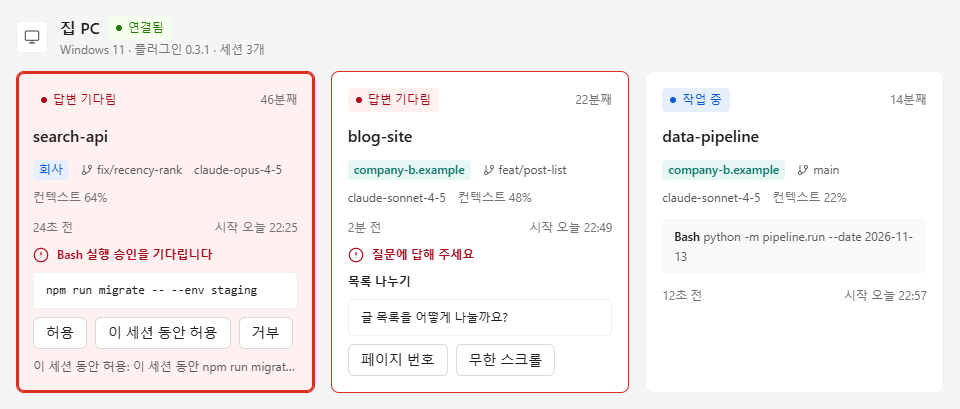
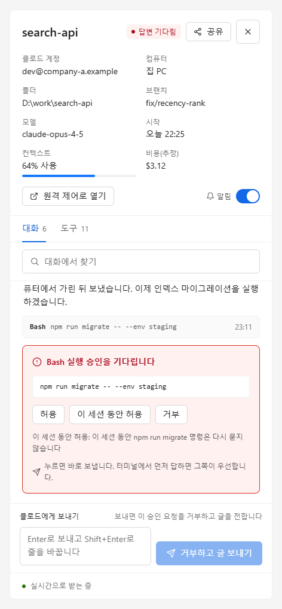
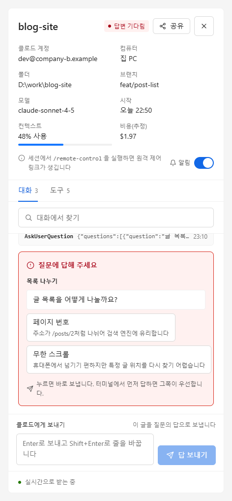
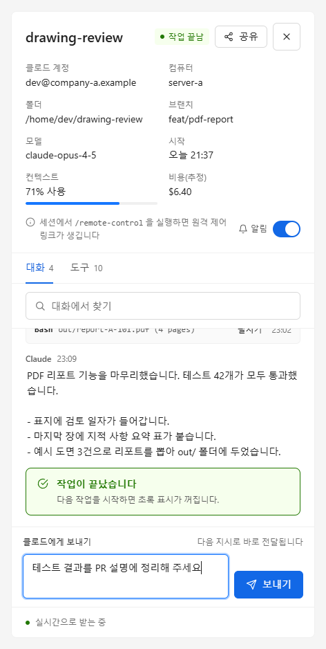
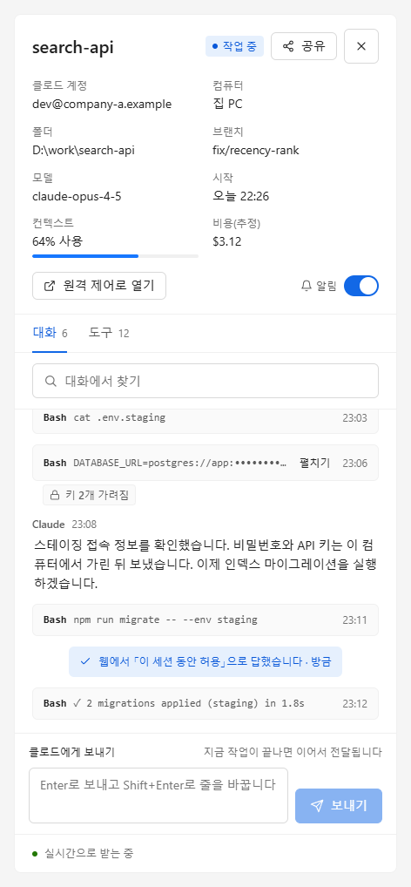
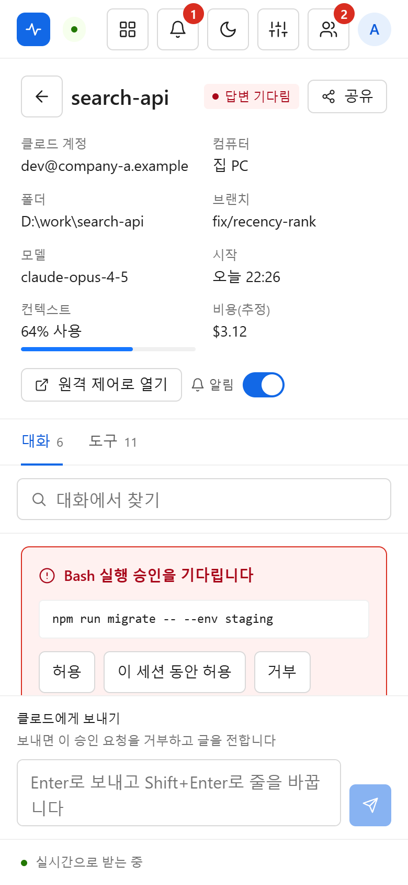
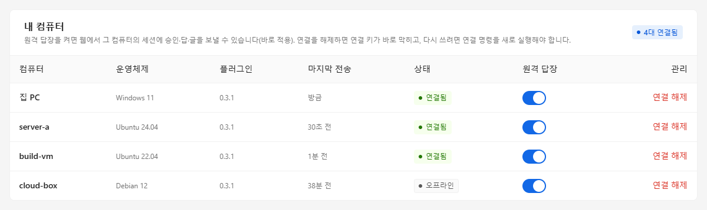

# 원격 답장

답을 기다리는 세션에 웹 대시보드에서 바로 답합니다. 터미널 앞에 없어도 휴대폰이나 다른 PC에서 실행 승인, 선택지 질문, 다음 지시를 보낼 수 있습니다. 텔레그램 알림에서 버튼으로 답하는 방법은 [알림](notifications.md#텔레그램으로-답하기)에 있습니다.

원격 답장은 플러그인 0.2.0 이상에서 됩니다. 지금 플러그인은 0.3.1이고, 웹에서 보낸 글의 수신 확인은 0.3.0부터 들어 있습니다([플러그인 — 업데이트](plugin.md#업데이트)).

## 할 수 있는 것

| 세션 상태 | 웹에서 하는 일 | 세션에서 일어나는 일 |
|---|---|---|
| 실행 승인을 기다림 | **허용 / 이 세션 동안 허용 / 거부** | 터미널 승인 창에서 고른 것과 같습니다 |
| 실행 승인을 기다림 | 글을 쓰고 **거부하고 글 보내기** | 거부하고, 클로드가 그 글을 읽고 다르게 진행합니다 |
| 선택지 질문(AskUserQuestion) | 선택지 누르기, 직접 쓴 답 보내기 | 그 답으로 질문이 끝나고 작업이 이어집니다 |
| 작업 끝남 | 글 보내기 | 세션이 그 글을 다음 요청으로 받아 다시 일합니다 |
| 작업 중 | 글 보내기 | 쌓아 두었다가 지금 작업이 끝나면 전달합니다 |
| 원격 제어를 켠 세션 | **원격 제어로 열기** | 클로드 공식 원격 제어 화면이 새 탭에서 열립니다 |

**버튼은 확인 창 없이 누르는 즉시 보냅니다.** 보낸 뒤에는 버튼이 잠기고 "보냈습니다 · 허용"처럼 결과가 잠시 보였다가, 세션이 다음 단계로 넘어가면 버튼째 사라집니다. 보내지 못하면 버튼이 다시 풀리고 까닭이 나옵니다.

## 카드에서 바로 답하기

승인이나 질문을 기다리는 세션은 대시보드 카드 안에 답 버튼이 붙습니다. 카드를 열지 않고 그 자리에서 누르면 됩니다.

- **실행 승인**: 무엇을 실행하려는지(명령, 파일 경로 등) 한 줄과 허용·이 세션 동안 허용·거부 버튼이 나옵니다.
- **선택지 질문**: 질문 머리말과 질문 글, 선택지 버튼이 나옵니다. 질문이 하나이고 하나만 고르는 질문이면 선택지를 누르는 즉시 보냅니다.
- 같은 세션에 기다리는 요청이 더 있으면 "외 N개 대기"가 붙습니다. 앞의 것에 답하면 다음 것이 나옵니다.

[간단히 보기](deck-mode.md)의 타일에는 버튼 대신 "승인 · 눌러서 답하기", "질문 · 눌러서 답하기"가 붙고, 누르면 상세 화면이 열립니다.

## 상세 패널에서 답하기

카드를 열면 대화 맨 아래에 같은 답 상자가 붙고, 패널 아래쪽에 글 입력창("클로드에게 보내기")이 있습니다.

<table>
<tr>
<td></td>
<td></td>
</tr>
<tr><td>실행 승인</td><td>선택지 질문</td></tr>
</table>

### 승인

- **허용**은 이번 한 번만 허용합니다.
- **이 세션 동안 허용**은 터미널 승인 창의 "Yes, and …" 선택지와 같습니다. 버튼 아래에 무엇이 허용되는지 한 줄로 적혀 있습니다(예: "이 세션 동안 npm run migrate 명령은 다시 묻지 않습니다"). 그 세션에만 적용되고 설정 파일에는 남지 않습니다. 클로드코드가 이 선택지를 주지 않는 요청에는 버튼이 나오지 않습니다.
- **거부**는 실행하지 않게 합니다. 까닭을 전하고 싶으면 입력창에 글을 쓰고 **거부하고 글 보내기**를 누릅니다. 클로드는 그 글을 읽고 다른 방법으로 진행합니다.

### 선택지 질문

- 선택지 버튼에는 클로드가 붙인 설명이 함께 나옵니다(카드에서는 버튼에 마우스를 올리면 보입니다).
- 여러 개를 고르는 질문은 "여러 개 고르기"라고 표시되고, 고른 뒤 **보내기**를 누릅니다. 고른 것은 쉼표로 이어 보냅니다.
- 질문이 여러 개면 질문마다 고르거나 "직접 입력" 칸에 쓰고, 모든 질문에 답해야 **보내기**가 눌립니다.
- 질문이 하나일 때는 아래 입력창에 쓴 글을 **답 보내기**로 직접 쓴 답으로 보낼 수 있습니다.

### 글 보내기

입력창에 쓰고 Enter를 누르거나 **보내기**를 누릅니다. 줄을 바꾸려면 Shift+Enter를 씁니다. 한글을 조합하는 중의 Enter는 글자를 확정할 뿐 보내지 않습니다. 한 번에 4000자까지 보낼 수 있습니다.

입력창 오른쪽 위의 설명이 지금 보내면 어떻게 되는지 알려 줍니다.

| 설명 | 뜻 |
|---|---|
| 다음 지시로 바로 전달됩니다 | 작업이 끝난 세션입니다. 세션이 그 글을 받아 바로 다시 일합니다 |
| 지금 작업이 끝나면 이어서 전달됩니다 | 작업 중인 세션입니다. 보낸 글은 "작업이 끝나면 전달됩니다 (N개 대기)"로 쌓였다가, 작업이 끝나는 순간 하나씩 전달됩니다 |
| 보내면 이 승인 요청을 거부하고 글을 전합니다 | 승인을 기다리는 세션입니다. 버튼 이름이 "거부하고 글 보내기"로 바뀝니다 |
| 이 글을 질문의 답으로 보냅니다 | 질문을 기다리는 세션입니다. 버튼 이름이 "답 보내기"로 바뀝니다 |

웹에서 보낸 글은 세션 대화에 사용자 글로 들어가고, 클로드는 그것을 사용자의 다음 요청으로 받아 처리합니다. 서버는 플러그인이 글을 세션에 넘겼다는 수신 확인을 받으면 글 본문을 지웁니다. 수신 확인이 오지 않으면(넘기기 직전에 클로드코드가 꺼진 경우 등) 잠시 뒤 같은 글을 다시 넘깁니다.

### 답한 기록

웹이나 텔레그램에서 답하면 그 세션 대화 사이에 시각 순으로 기록 한 줄이 끼어듭니다. 예를 들어 "웹에서 「이 세션 동안 허용」으로 답했습니다", "텔레그램에서 「허용」으로 답했습니다", "웹에서 글을 보냈습니다 「…」"처럼 나옵니다. 이 기록은 대화 기록과 같은 보관 기간을 따릅니다.

### 휴대폰에서

휴대폰에서는 상세가 화면 전체를 차지하고, 답 상자와 입력창이 화면 아래쪽에 놓입니다. 입력창을 누르면 키보드가 올라와도 입력창이 보이게 맞춥니다. 좁은 화면에서는 보내기 버튼에 아이콘만 남습니다.

## 터미널이 항상 우선입니다

웹에서 답을 기다리는 동안에도 터미널의 승인 창·질문 창은 그대로 떠 있고, **먼저 답한 쪽이 적용됩니다.**

- 터미널에서 먼저 답하면 플러그인이 다음 이벤트를 보낼 때 서버가 그 요청을 치우고, 웹의 버튼도 사라집니다.
- 버튼이 사라지기 전에 웹에서 눌렀다면 "이미 터미널에서 답했습니다"라고 알리고 세션에는 아무 영향이 없습니다.
- 서버가 꺼져 있거나 느리거나 무슨 문제가 있으면 플러그인은 아무것도 하지 않고 물러납니다. 그때는 평소처럼 터미널에서 답하면 됩니다. 플러그인이 승인 요청을 서버에 올리는 데 3초 넘게 걸리면 웹 답장을 포기하고 터미널에만 맡깁니다.

## 자동 모드에서는 승인 창이 없습니다

승인 창이 뜨지 않는 권한 모드(자동 승인, 승인 건너뛰기 등)에서는 클로드코드가 승인을 묻지 않으므로, 웹에도 승인 버튼이 나오지 않습니다. 이때도 세션 현황과 대화는 그대로 보이고, 작업이 끝난 세션에 글을 보내는 것은 됩니다. 편집만 자동으로 허용하는 모드처럼 일부만 자동인 경우에는 여전히 묻는 도구(명령 실행 등)만 웹에 나옵니다.

## 원격 제어로 열기

세션에서 클로드코드의 `/remote-control`을 켜 두면, 상세 패널 머리에 **원격 제어로 열기** 버튼이 생깁니다. 누르면 클로드의 공식 원격 제어 화면(`https://claude.ai/code/…`)이 새 탭에서 열립니다. 그 화면에서는 C-Monitor가 아니라 클로드가 직접 세션을 이어 줍니다.

아직 켜지 않은 세션에는 그 자리에 "세션에서 `/remote-control` 을 실행하면 원격 제어 링크가 생깁니다"라는 안내가 나옵니다. 원격 제어 주소는 플러그인이 훅 이벤트마다 함께 보내며, `https://claude.ai/code/`로 시작하는 주소만 링크로 씁니다. 종료·연락 끊김 세션과 보기만 하는 세션(공유받은 세션, 관리자가 남의 대시보드를 볼 때, 공개 링크)에는 버튼도 안내도 나오지 않습니다.

## 누가 답할 수 있나요

- **세션 주인 본인만** 답할 수 있습니다. 관리자도 다른 사용자의 세션에는 답하지 못하고, 공유받은 사람과 공개 링크로 보는 사람도 보기만 합니다. 서버가 남의 세션에 대한 답을 거절합니다.
- 종료되었거나 연락이 끊긴 세션에는 입력창이 나오지 않습니다.

## 컴퓨터별 스위치

[설정 › 내 컴퓨터](settings.md#내-컴퓨터)의 **원격 답장** 스위치로 컴퓨터마다 켜고 끕니다. 기본은 켜짐이고, 바꾸면 저장 버튼 없이 바로 적용됩니다. 관리자는 [관리 › 컴퓨터](admin.md#컴퓨터)에서 모든 사용자의 컴퓨터 스위치를 바꿀 수 있습니다.

끄면 그 컴퓨터의 세션에는 웹과 텔레그램에서 답하거나 글을 보낼 수 없고, 서버는 그 컴퓨터의 승인·질문 요청을 저장하지 않습니다. 세션 현황과 대화를 보는 기능은 그대로입니다. 상세 패널 아래에는 "이 컴퓨터는 원격 답장이 꺼져 있습니다. 설정의 내 컴퓨터에서 켤 수 있습니다."가 나옵니다.

플러그인이 0.2.0보다 낮은 컴퓨터는 스위치 옆에 "플러그인 업데이트 필요"가 붙고, 상세 패널에는 "웹에서 답하려면 이 컴퓨터의 플러그인을 0.2.0 이상으로 업데이트해 주세요."가 나옵니다.

## 원격 답장 때문에 더 보내는 것

| 언제 | 내용 |
|---|---|
| 승인 창이 뜰 때 | 세션 id, 도구 이름, 도구 입력(비밀을 가리고 큰 입력은 앞부분만), 서브에이전트 id, "이 세션 동안 허용"이 하는 일을 설명한 한 줄 |
| 선택지 질문이 뜰 때 | 위와 같고, 질문 글과 선택지(비밀 가림) |
| 훅 이벤트마다 | 원격 제어를 켠 세션이면 그 화면 주소 |

끝난 승인·질문 요청과 전달된 글은 7일 뒤 서버에서 지웁니다. 플러그인 쪽 동작은 [플러그인 — 원격 답장](plugin.md#원격-답장)에 정리했습니다.
