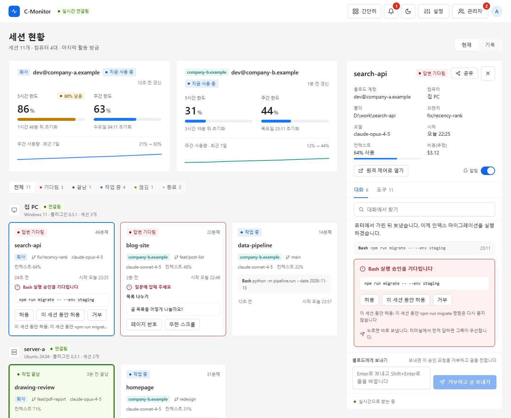
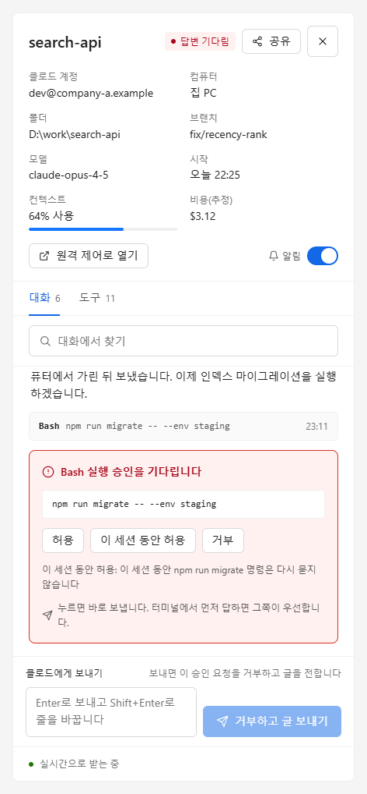
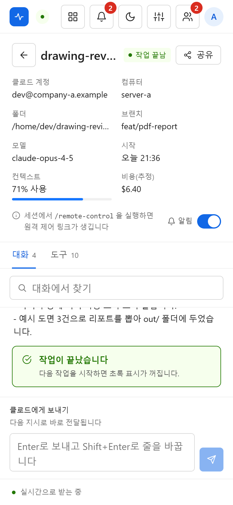
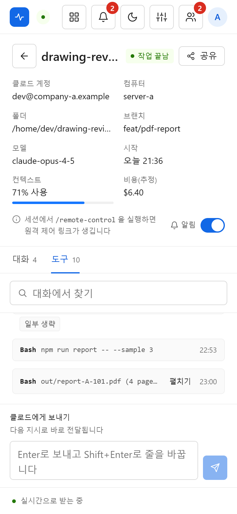
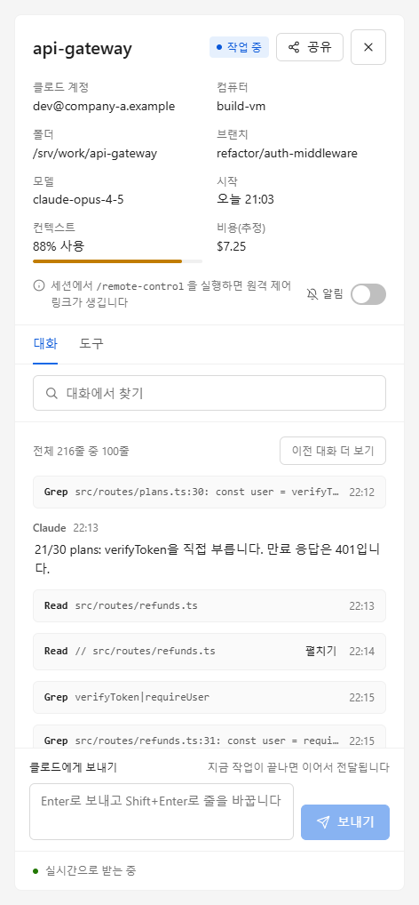
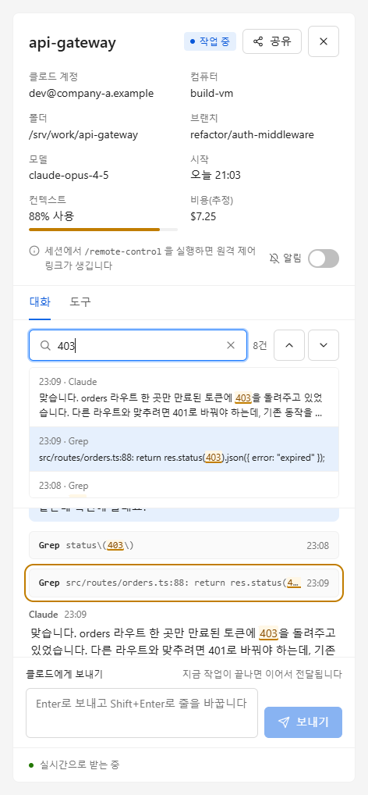
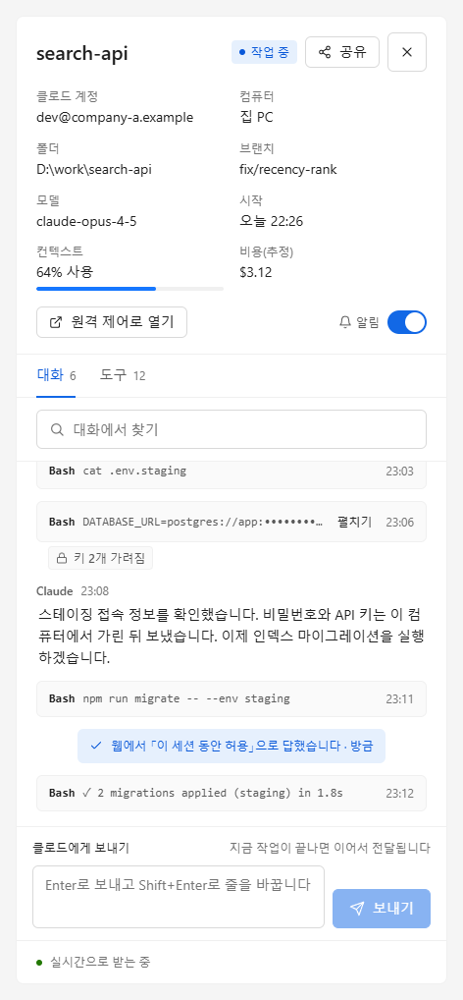
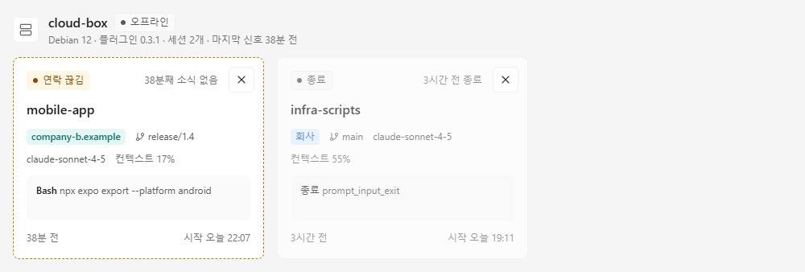

# 세션 상세

세션 카드를 누르면 그 세션의 상세 패널이 열립니다. PC(폭 1024px 이상)에서는 목록 오른쪽에 붙어 스크롤을 따라다니고, 그보다 좁은 화면에서는 화면 전체를 차지합니다. 닫기(×)나 왼쪽 위 화살표로 닫습니다.

## 머리 정보

패널 위쪽에는 폴더 이름과 상태 태그, 그리고 다음 정보가 나옵니다.

| 항목 | 내용 |
|---|---|
| 클로드 계정 | 이 세션이 쓰는 클로드 계정 이메일 |
| 컴퓨터 | 세션이 도는 컴퓨터 이름 |
| 폴더 | 작업 폴더 전체 경로 |
| 브랜치 | 작업 폴더의 깃 브랜치. 깃 저장소가 아니면 `—` |
| 모델 | 훅 입력에 담겨 온 모델 이름. 알려진 적이 없으면 `—` |
| 시작 | 이 세션의 가장 이른 이벤트 시각 |
| 컨텍스트 | 컨텍스트 창 사용률과 막대. 80% 이상은 주황, 95% 이상은 빨강([컨텍스트와 비용](#컨텍스트와-비용)) |
| 비용(추정) | 이 세션의 누적 비용(달러) |
| 공유한 사람 | 공유받은 세션일 때만 |

머리의 버튼은 다음과 같습니다. 보기만 하는 세션(공유받은 세션, 관리자가 남의 대시보드를 볼 때, 공개 링크)에서는 닫기 말고는 나오지 않습니다.

| 버튼 | 하는 일 |
|---|---|
| 공유 | 링크나 사람 지정으로 이 세션을 보여 줍니다([공유](sharing.md)) |
| 휴지통 | 종료·연락 끊김 세션만. 세션과 대화 기록을 지웁니다([세션 지우기](#세션-지우기)) |
| 원격 제어로 열기 | 세션에서 `/remote-control`을 켰을 때. 클로드 공식 원격 제어 화면을 새 탭에서 엽니다. 켜지 않았으면 그 자리에 켜는 방법이 한 줄로 나옵니다([원격 답장 — 원격 제어로 열기](remote-reply.md#원격-제어로-열기)) |
| 알림 스위치 | 이 세션의 텔레그램·웹 알림을 켜고 끕니다([알림 — 세션별로 끄기](notifications.md#세션별로-끄기)) |

### 컨텍스트와 비용

클로드코드가 상태줄을 그릴 때 넘겨주는 컨텍스트 사용률(`context_window`)과 누적 비용(`cost.total_cost_usd`)을 플러그인의 상태줄 래퍼가 세션별로 보냅니다. 값이 바뀌었을 때만, 세션마다 60초에 한 번까지 보냅니다. 그래서 플러그인 0.3.0 이상이고 상태줄이 한 번 이상 그려진 세션에만 나오고, 상태줄이 그려지는 동안에만 갱신됩니다.

비용은 클로드코드가 계산해 보여 주는 추정값입니다. 실제 청구 금액이나 구독 요금과는 다를 수 있습니다. 컨텍스트 사용률은 세션 카드에도 "컨텍스트 N%"로 나옵니다.

## 대화 탭과 도구 탭

**대화** 탭은 세션의 기록을 순서대로 보여 줍니다. 사용자 글은 파란 말풍선, 클로드의 글은 그 아래 평문, 도구 사용은 회색 상자 한 줄로 나옵니다. 도구 상자에는 도구 이름(Bash, Read, Edit 등)과 한 줄 내용, 시각이 들어갑니다. 도구를 부른 줄에는 입력 요약(명령, 파일 경로 등)이, 도구 결과 줄에는 결과의 첫 줄이 보입니다.

결과가 여러 줄이면 상자 오른쪽에 **펼치기**가 붙습니다. 누르면 그 아래에 전체 내용이 펼쳐지고, "접기"로 다시 접습니다.

**도구** 탭은 도구 사용 줄만 모아 보여 줍니다. 도구 호출과 그 결과가 각각 한 줄입니다.

<table>
<tr>
<td></td>
<td></td>
</tr>
<tr><td>대화 탭</td><td>도구 탭</td></tr>
</table>

탭 이름 옆 숫자(대화 탭은 사용자·클로드 글의 개수, 도구 탭은 도구 줄의 개수)는 **그 세션의 대화를 모두 불러왔을 때만** 나옵니다. 아래처럼 일부만 불러온 동안에는 숫자를 숨깁니다. 불러온 부분만 센 숫자가 전체처럼 보이지 않게 하려는 것입니다.

패널 맨 아래 줄은 "실시간으로 받는 중"처럼 지금 받는 상태를 알려 줍니다.

클로드의 생각 과정(thinking), 서브에이전트 안쪽 대화, 시스템 메시지는 플러그인이 보내지 않으므로 여기에도 나오지 않습니다. 자세한 범위는 [플러그인](plugin.md#무엇을-보내나요)에 있습니다.

## 100줄씩 불러오기

카드를 열면 그 세션의 **가장 최근 100줄**만 불러옵니다. 대화가 그보다 길면 대화 맨 위에 "전체 N줄 중 M줄"과 **이전 대화 더 보기** 버튼이 나옵니다. 버튼을 누를 때마다 그 앞의 100줄을 더 불러와 위에 붙이고, 보던 자리는 그대로 둡니다. 맨 처음 줄까지 불러오면 버튼이 사라지고 탭 숫자가 나타납니다.

여기서 "줄"은 서버에 저장된 대화 기록 한 줄로, 사용자 글 하나, 클로드 글 하나, 도구 호출 하나, 도구 결과 하나가 각각 한 줄입니다.

패널을 열면 맨 아래부터 보여 주고, 새 줄이 오면 따라 내려갑니다. 위로 올려 읽는 중에는 새 줄이 와도 화면이 움직이지 않고, 다시 맨 아래로 내리면 따라 내려가기가 이어집니다.

## 대화 검색

탭 아래의 "대화에서 찾기" 칸에 두 글자 이상 넣으면, 입력을 멈추고 잠시 뒤 서버가 **그 세션의 저장된 대화 전체**에서 찾습니다. 지금 불러온 100줄 안에서만 찾는 것이 아닙니다. 대소문자는 가리지 않고, 글 본문과 도구 이름에서 찾습니다.

- 검색 칸 오른쪽에 찾은 개수("8건")가 나오고, 그 아래에 결과 목록이 최신 줄부터 나옵니다. 결과마다 시각, 누구의 줄인지(사용자·Claude·도구 이름), 찾은 글자 주변을 자른 한 줄이 들어갑니다. 결과가 50건을 넘으면 최근 50건만 보여 주고 "최근 50건만 표시"라고 알립니다.
- 결과를 누르면 대화가 그 줄로 옮겨 가 가운데에 놓이고, 그 줄에 테두리가 둘립니다. 그 줄이 아직 불러오지 않은 과거라면 그 줄을 가운데로 한 100줄을 새로 불러옵니다. 도구 탭을 보던 중에 글 줄을 고르면 대화 탭으로 바뀝니다. 찾은 글자가 접힌 도구 결과 안에 있으면 그 상자를 펼쳐 둡니다.
- 위·아래 화살표 버튼으로 결과를 하나씩 옮겨 다닙니다. 위(▲)는 더 오래된 결과, 아래(▼)는 더 최근 결과입니다. 검색 칸에서 Enter를 누르면 다음(더 오래된) 결과로, Esc를 누르면 검색을 지웁니다.
- 찾은 글자는 결과 목록과 화면에 보이는 대화 줄 모두에서 노란색으로 강조됩니다.
- 폭이 1024px보다 좁은 화면에서는 "목록 접기"·"목록" 버튼이 따로 있고, 결과를 고르면 목록이 접혀 대화를 넓게 보여 줍니다.

### 과거를 보는 중에 새 대화가 오면

검색으로 과거의 줄을 보는 동안에는 새로 들어오는 줄을 그 자리에 이어 붙이지 않습니다. 대신 대화 아래쪽에 **최신으로** 버튼이 뜨고, 그사이 새 줄이 오면 "새 대화 N줄 · 최신으로"처럼 개수를 알려 줍니다. 버튼을 누르면 가장 최근 100줄을 다시 불러와 맨 아래로 내려가고, 실시간 따라가기가 이어집니다. 과거를 보는 동안에는 아래쪽 상태 상자도 나오지 않습니다.

## 가려진 비밀과 생략 표시

플러그인은 대화를 보내기 전에 API 키·토큰·비밀번호처럼 보이는 글자를 `••••••••`로 바꿉니다. 그런 줄 아래에는 자물쇠 아이콘과 함께 "키 N개 가려짐"이 붙습니다. 원래 값은 서버에 오지 않으므로 대시보드에서 되살릴 방법은 없습니다.

너무 길어서 잘린 줄에는 "일부 생략"이 붙습니다. 글 한 줄은 64KB, 도구 입력은 32KB가 넘으면 잘립니다. 가림 규칙과 크기 한도는 [플러그인](plugin.md#비밀-가림) 문서에 정리했습니다.

## 아래쪽 상태 상자

대화 탭 맨 아래에는 세션 상태에 따라 상자가 하나 붙습니다(최신 줄을 보고 있을 때만).

| 상태 | 상자 |
|---|---|
| 승인·질문을 기다림(웹에서 답할 수 있을 때) | 빨간 답 상자. 실행하려는 내용과 허용·이 세션 동안 허용·거부 버튼, 또는 질문과 선택지 버튼([원격 답장](remote-reply.md)) |
| 답변 기다림(그 밖) | 빨간 상자. 마지막 알림 내용과 "해당 컴퓨터의 터미널에서 답해 주세요". 보기만 하는 세션이면 "세션 주인이 답하면 이어서 진행됩니다" |
| 한도 초과 | 빨간 상자. "한도가 초기화되면 해당 컴퓨터의 터미널에서 이어 가 주세요" |
| 작업 끝남 | 초록 상자. "다음 작업을 시작하면 초록 표시가 꺼집니다" |
| 연락 끊김 | 주황 상자. 소식이 없던 시간과 마지막 신호 시각 |
| 종료 | 회색 상자. 끝난 시각 |

승인 창이 뜨지 않은 알림(예: 클로드가 입력을 기다린다는 알림)이나 플러그인이 0.2.0보다 낮은 컴퓨터의 세션에는 웹 답 버튼이 나오지 않으니, 그 컴퓨터의 터미널에서 답합니다.

## 글 입력창

내 세션이고 웹에서 답할 수 있으면 패널 아래쪽에 **클로드에게 보내기** 입력창이 있습니다. 작업이 끝난 세션에는 다음 지시로 바로 전달되고, 작업 중인 세션에는 작업이 끝난 뒤 전달됩니다. 승인을 기다리는 중이면 "거부하고 글 보내기", 질문을 기다리는 중이면 "답 보내기"로 바뀝니다. Enter로 보내고 Shift+Enter로 줄을 바꿉니다. 자세한 규칙은 [원격 답장 — 글 보내기](remote-reply.md#글-보내기)에 있습니다.

입력창 자리에 다음 같은 한 줄이 나오면 지금은 웹에서 답할 수 없다는 뜻입니다.

| 한 줄 | 까닭 |
|---|---|
| 이 컴퓨터는 원격 답장이 꺼져 있습니다. 설정의 내 컴퓨터에서 켤 수 있습니다. | [설정 › 내 컴퓨터](settings.md#내-컴퓨터)의 원격 답장 스위치가 꺼져 있습니다 |
| 웹에서 답하려면 이 컴퓨터의 플러그인을 0.2.0 이상으로 업데이트해 주세요. | 플러그인이 낮습니다([플러그인 — 업데이트](plugin.md#업데이트)) |
| …님이 공유한 세션입니다. 보기만 할 수 있습니다. | 공유받은 세션입니다 |
| 읽기 전용으로 보고 있습니다. 답장·삭제·설정은 바꿀 수 없습니다. | 관리자가 남의 대시보드를 보고 있습니다 |

종료되었거나 연락이 끊긴 세션에는 입력창도 이런 한 줄도 나오지 않습니다.

## 답 기록 줄

웹이나 텔레그램에서 답하면 대화 줄 사이에 시각 순으로 "웹에서 「허용」으로 답했습니다", "텔레그램에서 「허용」으로 답했습니다", "웹에서 글을 보냈습니다 「…」" 같은 기록 줄이 끼어듭니다. 터미널에서 답한 것은 따로 표시하지 않습니다.

## 세션 지우기

종료된 세션과 연락이 끊긴 세션은 지울 수 있습니다. 지우기 버튼은 세 군데에 있습니다.

- 대시보드 세션 카드 오른쪽 위의 × 버튼
- [간단히 보기](deck-mode.md) 타일 오른쪽 위의 × 버튼
- 상세 패널 머리의 휴지통 버튼

> **확인 창 없이 한 번 누르면 바로 지워지고, 되돌릴 수 없습니다.** 화면에서 카드가 곧바로 사라지고, 서버에서도 그 세션과 **저장된 대화 기록 전체**가 지워집니다. 보관 기간을 기다리지 않고 즉시 지워지며, 휴지통이나 복구 기능은 없습니다.

- 답변 기다림·한도 초과·작업 끝남·작업 중인 세션에는 지우기 버튼이 없습니다. 서버도 그런 세션의 삭제 요청은 받지 않습니다.
- 서버가 지우지 못하면(네트워크 오류 등) 카드가 원래 자리로 돌아오고 "세션을 지우지 못했습니다. 잠시 뒤 다시 시도해 주세요."라는 알림이 잠시 나옵니다.
- 같은 계정으로 연 다른 브라우저·기기의 화면에서도 그 카드가 함께 사라집니다.
- 자기 세션만 지울 수 있습니다. 관리자도 다른 사용자의 세션은 지우지 못합니다.
- 지운 세션에서 새 작업이 시작되면(질문, 도구 실행 등) 카드가 새로 만들어집니다. 이때 지운 대화는 돌아오지 않고, 그 뒤에 생긴 대화만 쌓입니다. 지우기 전에 생긴 이벤트가 늦게 도착하거나 종료 알림만 온 경우에는 다시 생기지 않습니다.
