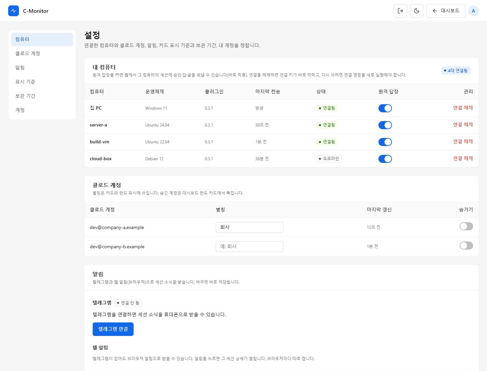
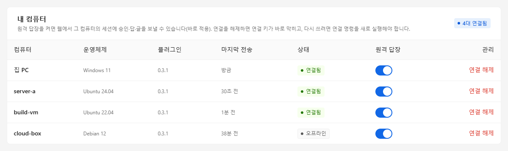

# 설정

대시보드 헤더의 "설정"을 누르면 열립니다. 왼쪽 메뉴(컴퓨터, 클로드 계정, 알림, 표시 기준, 보관 기간, 계정)로 각 부분을 오갑니다. 여기서 바꾸는 값은 모두 지금 로그인한 대시보드 계정에만 적용됩니다.

화면 오른쪽 위에는 로그아웃 버튼과 테마 버튼, 대시보드로 돌아가는 버튼이 있습니다.

## 내 컴퓨터

내 계정으로 연결한 컴퓨터 목록입니다. 컴퓨터 이름, 운영체제, 플러그인 버전, 마지막 전송 시각, 연결 상태(마지막 전송이 10분 안이면 "연결됨"), 원격 답장 스위치가 나옵니다.

### 원격 답장 스위치

컴퓨터마다 웹(과 텔레그램)에서 그 컴퓨터의 세션에 승인·답·글을 보낼 수 있는지 정합니다. 기본은 켜짐이고, 누르면 저장 버튼 없이 바로 적용됩니다. 끄면 서버가 그 컴퓨터의 승인·질문 요청을 저장하지 않고, 웹에서도 답할 수 없습니다. 세션 현황과 대화는 그대로 보입니다. 플러그인이 0.2.0보다 낮으면 스위치 옆에 "플러그인 업데이트 필요"가 붙습니다. 자세한 내용은 [원격 답장 — 컴퓨터별 스위치](remote-reply.md#컴퓨터별-스위치)에 있습니다.

### 연결 해제

"연결 해제"를 누르면 버튼이 "해제 확인"으로 바뀌고, 한 번 더 누르면 해제됩니다. 해제하면 다음 일이 일어납니다.

- 그 컴퓨터의 연결 키(기기 토큰)가 서버에서 바로 막힙니다. 그 뒤로 그 컴퓨터가 보내는 내용은 서버가 받지 않습니다.
- 그 컴퓨터와 그 세션들이 대시보드에서 빠집니다. 이미 저장된 대화가 이때 지워지지는 않고, 보관 기간이 지나면 정리됩니다.
- 그 컴퓨터의 플러그인은 다음 전송 때 서버가 연결을 해제했다는 것을 알아채고, 못 보낸 묶음을 버린 뒤 더 보내지 않고 멈춥니다. 그 컴퓨터에서 `/c-monitor:connect`(또는 `--status`)를 실행하면 "서버에서 연결이 해제되었습니다"라고 알려 줍니다.
- 그 컴퓨터를 다시 쓰려면 그 컴퓨터에서 연결 명령(`/c-monitor:connect <서버주소>`)을 새로 실행해야 합니다. 다시 연결하면 전송이 이어집니다.

웹에서 해제해도 그 컴퓨터의 상태줄 설정은 플러그인 래퍼를 가리킨 채 남습니다(래퍼는 원래 상태줄을 그대로 보여 주고, 해제된 뒤로는 한도를 보내지 않습니다). 상태줄 설정까지 원래대로 돌리려면 그 컴퓨터에서 `/c-monitor:connect --disconnect`를 실행해 주세요([플러그인 — 연결 해제](plugin.md#연결-해제)).

## 클로드 계정

지금까지 기록된 클로드 계정 목록입니다. 계정마다 별칭을 넣고 숨기기를 켜고 끌 수 있습니다.

- **별칭**(60자까지)은 한도 카드와 세션 카드의 계정 이름표에 이메일 도메인 대신 쓰입니다. 비우면 도메인으로 돌아갑니다.
- **숨기기**를 켜면 그 계정은 대시보드 한도 카드에서 빠집니다. 세션 카드와 기록 수집에는 영향이 없습니다.

자세한 내용은 [사용 한도](limits.md#별칭과-숨기기)에 있습니다.

## 알림

텔레그램 연결, 이 브라우저에서 웹 알림 받기, 알림 항목(답을 기다릴 때·작업이 끝났을 때·연락이 끊겼을 때·한도가 기준을 넘을 때), 이 브라우저의 웹 알림 소리를 정합니다. 이 부분의 스위치와 숫자는 저장 버튼 없이 바로 저장됩니다. 자세한 내용은 [알림](notifications.md)에 있습니다.

## 표시 기준

| 항목 | 기본값 | 넣을 수 있는 값 | 뜻 |
|---|---|---|---|
| 연락 끊김으로 표시 | 10분 | 1~1440분 | "…분 동안 소식이 없을 때". 작업 중인 세션이 이 시간 넘게 소식이 없으면 "연락 끊김"(주황 점선)으로 바꿉니다 |
| 종료 카드 유지 | 24시간 | 0~8760시간 | "…시간 뒤 목록에서 숨깁니다". 종료된 세션을 끝난 뒤 이 시간 동안 대시보드에 남겨 두고, 그 뒤에는 목록에서 숨깁니다. 0이면 끝나자마자 숨깁니다 |

범위는 서버가 받아들이는 값과 같습니다. 범위를 벗어나거나 정수가 아니면 저장할 때 "…에는 1부터 1440까지의 정수를 넣어 주세요."처럼 알려 주고 저장하지 않습니다.

연락 끊김 판정은 서버가 1분마다 합니다. 그래서 기준을 넘은 뒤 실제로 색이 바뀌기까지 최대 1분쯤 늦을 수 있습니다. 끊김으로 바뀐 세션도 그 세션에서 새 이벤트가 오면 그 이벤트에 맞는 상태(작업 중, 작업 끝남 등)로 다시 바뀝니다.

종료 카드 유지 시간이 지난 세션은 대시보드의 "현재" 목록에서만 빠지고, [기록](dashboard.md#기록)에서는 계속 보입니다. 기록까지 지우려면 카드의 지우기 버튼을 쓰세요([세션 상세 — 세션 지우기](session-detail.md#세션-지우기)). 유지 시간을 바꿔 저장하면 대시보드 목록이 바로 다시 계산됩니다.

## 보관 기간

| 항목 | 기본값 | 넣을 수 있는 값 |
|---|---|---|
| 대화 기록 | 30일 | 0~3650일. 0은 지우지 않음 |
| 사용량 기록 | 90일 | 0~3650일. 0은 지우지 않음 |

서버는 매일 새벽 4시(한국 시간)에 보관 기간이 지난 기록을 지웁니다. 대화 기록은 줄마다 그 줄이 생긴 시각을 기준으로 지우므로, 오래 이어진 세션은 앞쪽 대화부터 사라집니다. 웹·텔레그램 답 기록 줄도 대화 기록과 같은 기간을 따릅니다. 사용량 기록은 한도 카드에 쓰이는 5시간·주간 사용률 기록입니다.

0을 넣어 지우지 않게 해도, [저장 용량](account.md#저장-용량) 한도를 넘으면 기간과 상관없이 오래된 대화부터 지웁니다(최근 24시간 대화는 남깁니다).

이때 지우는 것은 대화 줄과 사용량 기록입니다. 세션 카드의 요약 정보(폴더, 브랜치, 상태, 마지막 활동 한 줄)는 이 정리로 지워지지 않습니다. 세션 하나를 요약 정보와 대화까지 통째로 지우려면 그 카드의 지우기 버튼을 씁니다(종료·연락 끊김 세션만).

## 저장

표시 기준·보관 기간·별칭·숨기기는 아래 "저장"을 눌러야 반영됩니다. "되돌리기"는 마지막으로 저장한 값으로 돌립니다. 컴퓨터 연결 해제, 원격 답장 스위치, 알림 설정은 저장 버튼 없이 바로 적용됩니다.

## 계정

로그인한 Gmail 계정과 권한, 가입 고지에 동의한 시각, 내 저장 용량과 한도, 탈퇴가 있습니다. 자세한 내용은 [계정](account.md)에 있습니다.
