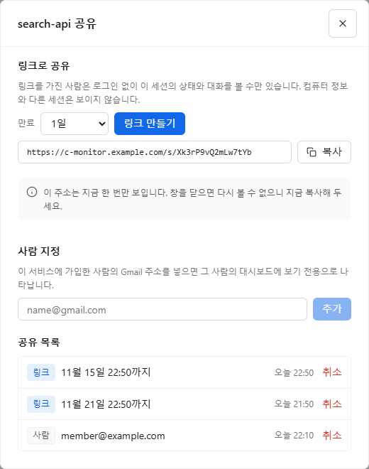
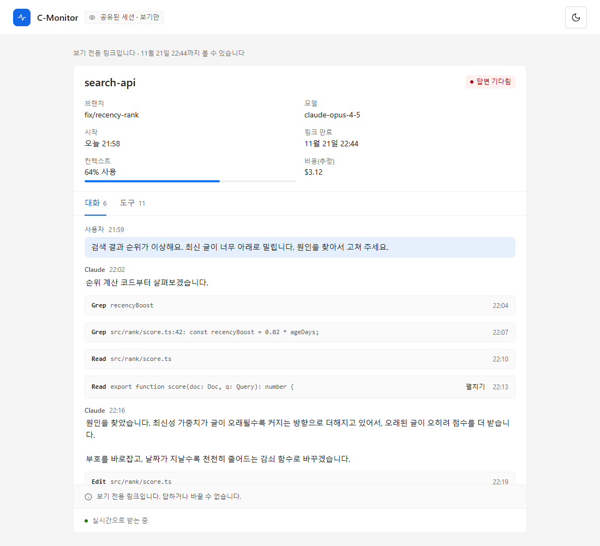
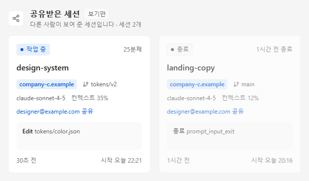

# 공유

세션 하나를 다른 사람에게 보여 줍니다. 방법은 두 가지입니다.

| 방법 | 누가 보나 | 로그인 |
|---|---|---|
| 링크로 공유 | 링크를 가진 누구나 | 필요 없음 |
| 사람 지정 | 이 서비스에 가입한 사람 중 지정한 사람 | 필요. 그 사람 대시보드의 "공유받은 세션" 묶음에 보입니다 |

어느 쪽이든 **보기만** 할 수 있습니다. 공유받은 사람은 답하거나, 원격 제어로 열거나, 지우거나, 설정을 바꿀 수 없습니다. 공유할 수 있는 사람은 그 세션의 주인뿐입니다.

## 공유 창

세션 상세 패널 머리의 **공유** 버튼을 누르면 공유 창이 열립니다. Esc나 바깥을 눌러 닫습니다.

### 링크로 공유

1. **만료**를 고릅니다: 1시간, 1일(기본), 7일, 없음.
2. **링크 만들기**를 누르면 주소가 나옵니다. **복사**를 눌러 보낼 곳에 붙여 넣습니다.

> **링크 주소는 만들 때 한 번만 보입니다.** 서버는 링크의 열쇠를 해시로만 저장하므로 창을 닫으면 같은 주소를 다시 볼 수 없습니다. 잃어버렸다면 새 링크를 만들고 옛 링크는 취소해 주세요.

링크를 가진 사람은 누구든 열 수 있으니, 필요한 사람에게만 보내고 만료를 짧게 두는 편이 안전합니다.

### 사람 지정

이 서비스에 가입한 사람의 Gmail 주소를 넣고 **추가**를 누릅니다. 그 사람의 대시보드에 "공유받은 세션" 묶음이 생기고 이 세션이 보기 전용으로 나타납니다. 가입하지 않은 주소나 자기 자신에게는 공유할 수 없습니다.

### 공유 목록과 취소

공유 창 아래의 목록에 이 세션의 링크(만료 시각)와 지정한 사람이 나옵니다. **취소**를 누르면 그 링크는 바로 열리지 않고, 지정한 사람의 대시보드에서도 빠집니다. 만료된 링크는 매일 새벽 정리 때 목록에서 지워집니다.

## 링크로 연 화면

링크를 열면 로그인 없이 그 세션 하나만 보이는 화면이 나옵니다. 맨 위에 "공유된 세션 · 보기만"과 만료 시각이 적혀 있습니다.

- 보이는 것: 세션 이름, 상태, 브랜치, 모델, 시작 시각, 링크 만료, 컨텍스트 사용률과 비용, 대화와 도구 기록(100줄씩, "이전 대화 더 보기"), 실시간 갱신.
- **보이지 않는 것**: 컴퓨터 이름, 클로드 계정, 작업 폴더 경로, 같은 사람의 다른 세션, 답 버튼과 입력창, 원격 제어 링크, 대화 검색. 서버가 이 값들을 아예 내려 주지 않습니다.
- 대화 안에 들어 있는 내용(명령 출력, 읽은 파일 내용 등)은 그대로 보입니다. 비밀처럼 보이는 글자는 이미 플러그인이 가려 보낸 상태이지만 빠지는 것이 있을 수 있으니([플러그인 — 비밀 가림](plugin.md#비밀-가림)), 공유하기 전에 대화를 한 번 훑어보세요.

링크가 만료되었거나 취소되었거나 세션이 지워졌으면 "볼 수 없는 링크입니다"가 나옵니다. 세션 주인이 탈퇴하면 그 사람의 공유 링크도 바로 막힙니다.

## 공유받은 세션

사람 지정으로 공유받으면 내 대시보드 맨 아래에 **공유받은 세션** 묶음이 생깁니다. 카드에는 "designer@example.com 공유"처럼 공유한 사람이 붙고, 상세 패널 머리에도 "공유한 사람"이 나옵니다.

- 상세 패널 아래에는 "…님이 공유한 세션입니다. 보기만 할 수 있습니다."가 나오고, 답 버튼·입력창·원격 제어·알림 스위치·공유·지우기가 모두 없습니다.
- 공유받은 세션은 알림을 보내지 않고, 헤더 종 아이콘 숫자와 웹 알림 소리에도 들어가지 않습니다.
- 상태 필터는 공유받은 세션에도 적용됩니다. [기록](dashboard.md#기록)에는 공유받은 세션이 나오지 않습니다.
